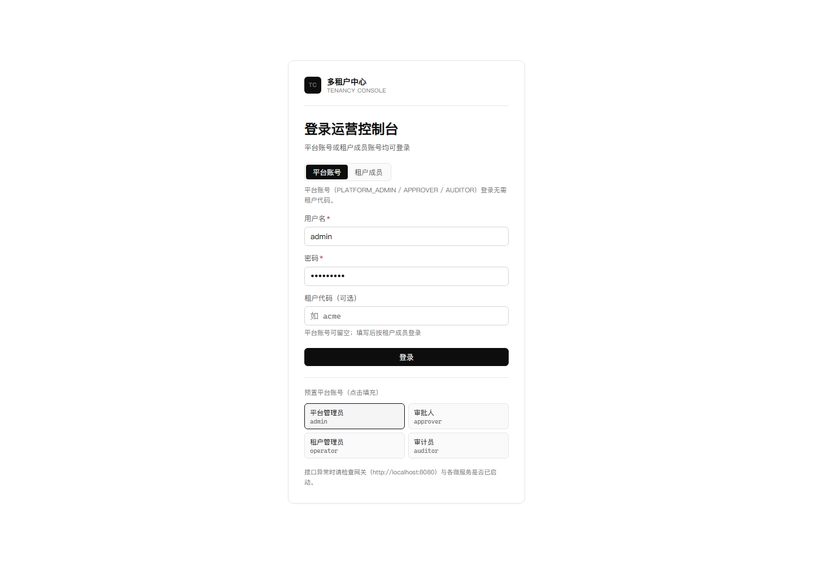
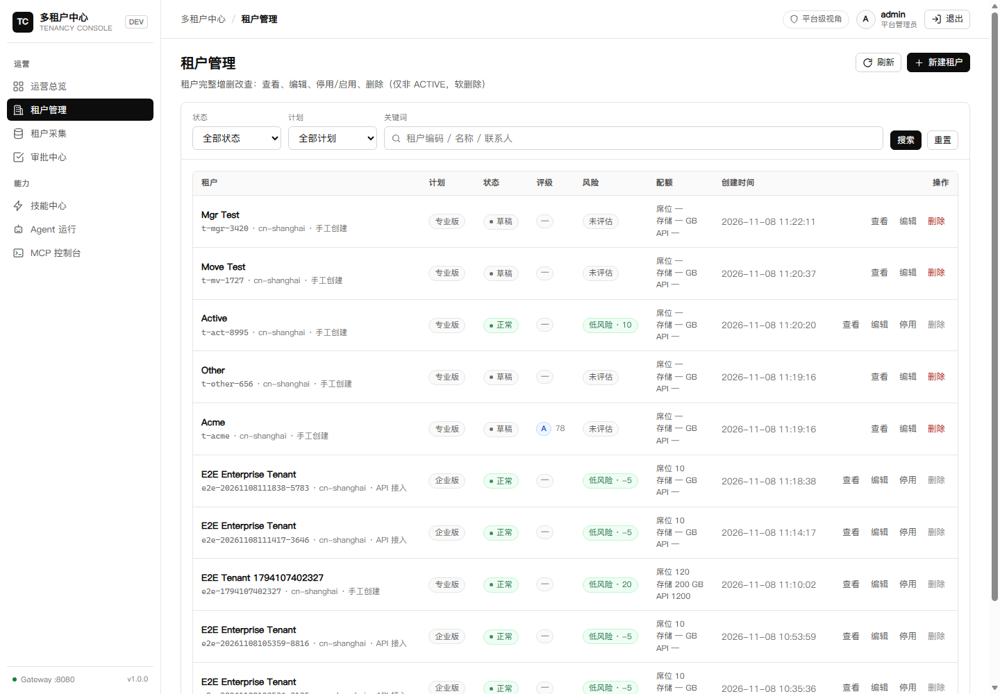
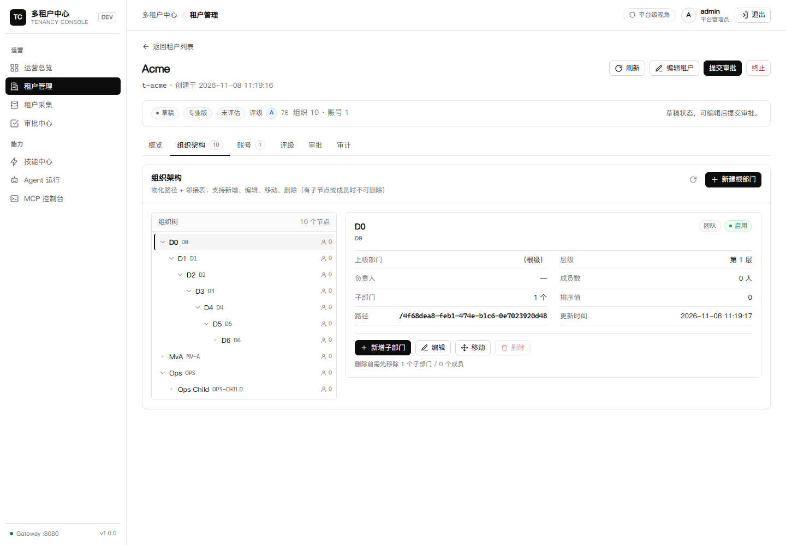

# 九鼎 · 多租户智能中枢

**Jiuding · Multi-Tenant Intelligence Hub** ｜ 工程名 `jiuding`

[](LICENSE)
[](pom.xml)
[](pom.xml)
[](frontend/package.json)
[](docs/10-acceptance-report.md)

> ⚠️ **预发布（0.9.0）· 非生产级**：本仓库是可运行、可验证、可二次开发的**多租户中心参考实现**，用于学习、评估与原型验证，不建议直接承载真实生产租户与敏感数据。生产化缺口见 [产品指引](docs/PRODUCT_GUIDE.md#0-先读这一段产品定位与非生产级声明)。

九鼎把「租户」作为一等公民，将 **租户全生命周期、Agent 审批、Skill 规则、MCP 开放接口、组织/账号/评级、五档 RBAC、SSO/MFA/SCIM** 串成一条可运行的端到端工程：Java 17 + Spring Boot 微服务 + AgentScope + React 控制台 + PostgreSQL + Docker/k3s。

---

## 亮点

- **租户全生命周期**：申请入驻 → Agent 合规审查 → 自动/人工审批 → 开通 → 运营 → 停用/软删
- **Agentic 工作流**：AgentScope ReActAgent + 确定性 Skill 规则引擎（双消费、可审计、热加载）
- **技能中心**：卡片分块 + 单 Skill 六页签（内容/代码/审查/调试/版本/启用）
- **MCP 生态**：22 工具、SSE、按人 API Key、调用审计、外部 MCP 服务器配置
- **企业身份**：平台/租户双通道登录、OIDC/SSO、MFA（TOTP+恢复码）、SCIM 2.0
- **治理与合规**：五档 RBAC + 权限矩阵、审计导出、PII 掩码、登录限流、数据生命周期
- **配额与用量**：席位/组织配额强制（409）、用量 API、网关按租户 API RPM 限流（429）、控制台进度卡
- **运维**：k3s 随机 Secret 生成、PostgreSQL 四库备份/恢复、零中断滚动检查
- **双环境交付**：Docker Compose 全栈 + k3s 生产 overlay（2 副本/PDB/HPA/CronJob/零中断）
- **可验证**：473 自动化测试 + 6 套 E2E + 17 项统一验证脚本

## 界面

| 登录（平台/租户/SSO） | 租户管理 | 组织架构 |
|---|---|---|
|  |  |  |

## 架构

```
 Browser ──▶ frontend (React/TS) ──▶ gateway (8080)
                                      │
        ┌─────────────┬───────────────┼────────────────┐
        ▼             ▼               ▼                ▼
   tenant-service  approval-svc   agent-service    mcp-service
   (:8081)         (:8082)        (:8083)          (:8084)
   租户/组织/账号   审批/自动化     Skill/Agent      22 MCP 工具
   评级/入驻/SCIM                 技能中心          Key/审计/外部 MCP
        │             │               │                │
        └─────────────┴───────┬───────┴────────────────┘
                              ▼
                    PostgreSQL (4 DBs, Flyway)
```

- 身份：平台 JWT 用户与租户账号目录分离；租户账号 JWT 携带 `tid/oid`，驱动子树 RBAC
- 数据：`tenant_db / approval_db / agent_db / mcp_db`，Flyway 迁移，H2/Postgres 双兼容
- 入口：`gateway` 负责登录、限流、路由、聚合；CLI 与 MCP 客户端复用同一 API

## 快速开始

### Docker Compose（最短路径）
```bash
cd deploy
cp .env.example .env
docker compose -f docker-compose.yml -f docker-compose.local.yml up -d --build
# 前端 http://localhost:8088 · 网关 http://localhost:8080
```

### Kubernetes（k3s，已验证）
```sh
sh deploy/k8s/deploy.sh          # 首次部署自动生成随机 Secret（deploy/k8s/gen-secrets.sh）
sh deploy/k8s/publish.sh start
# 前端 http://localhost:30088 · 网关 http://localhost:30080
sh deploy/k8s/prod/apply-prod.sh      # 生产 overlay：多副本/PDB/HPA/CronJob
```

### 本地进程
```powershell
mvn -B -DskipTests install
pwsh scripts/run-local.ps1
cd frontend; npm install; npm run dev
pwsh scripts/verify.ps1 -BaseUrl http://localhost:18080
```

### 演示账号（仅本地）
`admin / Admin@123`（平台管理员）· `approver / Approver@123` · `operator / Operator@123`（租户管理员）· `auditor / Auditor@123`
> 公网/生产前必须删除或改密，并替换所有默认密钥（`.env.example` 与 `SECURITY.md`）。

## 目录

```
jiuding/
├─ agent-kernel/ tenancy-common/ tenant-service/ approval-service/
├─ agent-service/ mcp-service/ gateway/ tenancy-cli/
├─ frontend/            # React + TS 控制台
├─ skills/              # 5 个内置技能包
├─ deploy/              # compose / Dockerfile / k8s（含 prod overlay）
├─ scripts/ tests/ integration/
├─ docs/                # 产品指引/架构/API/数据/规范/验收/开源指引
└─ LICENSE NOTICE THIRD_PARTY_LICENSES.md
```
详见 [仓库结构](docs/REPO_STRUCTURE.md)。

## 文档

| 文档 | 说明 |
|---|---|
| [产品指引](docs/PRODUCT_GUIDE.md) | 定位、非生产级声明、流程、配置、路线图 |
| [法律与合规](docs/LEGAL.md) | 许可证、商标、专利、隐私、导出与分发义务自查 |
| [GitHub 开源提交指引](docs/OPEN_SOURCE_GUIDE.md) | 许可证合规、仓库配置、CI、Release 清单 |
| [仓库结构](docs/REPO_STRUCTURE.md) | 目录规范、命名、重构记录 |
| [架构设计](docs/01-architecture.md) | 上下文/组件/状态机/部署/ADR |
| [API 契约](docs/02-api-contracts.md) | REST/SCIM/MCP 契约 |
| [数据模型](docs/03-data-model.md) | 多租户数据模型与隔离 |
| [Skill 规范](docs/04-skill-spec.md) / [MCP 规范](docs/05-mcp-spec.md) | 规则 DSL 与 MCP 工具 |
| [运维部署](docs/06-devops.md) | Docker/k3s/生产化 |
| [验收报告](docs/10-acceptance-report.md) | 473 测试 / E2E / 实测数据 |
| [v3 RBAC](docs/13-v3-account-login-rbac.md) · [v4 安全合规](docs/14-v4-security-compliance-production.md) · [v5 技能/MCP/RBAC](docs/15-v5-skill-mcp-onboarding-rbac.md) · [v6 SSO/MFA/SCIM](docs/16-v6-sso-mfa-scim.md) · [v7 配额/备份](docs/17-v7-quota-usage-backup.md) | 版本演进 |

## 验证

```powershell
mvn -B -f pom.xml test                                    # 473 tests
cd frontend; npm run build                                # 0 errors
pwsh scripts/verify.ps1 -BaseUrl http://localhost:30080   # 17 checks
```
E2E：`tests/e2e.ps1`、`e2e-v2`、`e2e-v3`、`e2e-v4`、`e2e-v5`、`e2e-skill`、`e2e-v6`、`e2e-v6b`（SCIM）、MCP 冒烟。

## 安全

- 报告漏洞：见 [SECURITY.md](SECURITY.md)（私密）
- 默认密钥/演示账号仅用于本地；生产必须替换
- 已知限制：共享 schema 应用层隔离、登录限流进程内、OIDC PKCE verifier 进程内、未做 RLS

## 许可证

自研代码与文档采用 **Apache License 2.0**（见 [LICENSE](LICENSE)），版权人 **suhong**。
第三方组件保留其各自许可证，详见 [THIRD_PARTY_LICENSES.md](THIRD_PARTY_LICENSES.md)、[NOTICE](NOTICE) 与 [LICENSES/](LICENSES/)。

### 法律与商标声明

- **非关联**：本项目为独立开源项目，与 AgentScope/Alibaba、OpenAI、以及任何使用“九鼎 / Jiuding”名称的公司或产品**无关联、无背书**。
- **“九鼎 / Jiuding”** 为项目代号，本项目不主张商标权；商业使用前请自行做商标检索/注册。
- **Codex-inspired** 仅描述视觉风格参考，与 OpenAI Codex 无关联、无背书。
- **演示数据**：仓库内租户/账号/邮箱/手机号均为虚构数据；默认账号与密钥仅用于本地。
- **非生产级**：0.9.0 为预发布，按 Apache-2.0 “AS IS” 提供，不附带担保。
- 详细法律风险自查与分发义务见 [docs/LEGAL.md](docs/LEGAL.md)。

## 作者

**suhong** · 欢迎 Issue / PR（见 [CONTRIBUTING.md](CONTRIBUTING.md) 与 [CODE_OF_CONDUCT.md](CODE_OF_CONDUCT.md)）。
