# 01 · 架构设计（评审稿 v1.0）

> 本文是多租户中心平台的架构设计基线，面向用户评审与后续模块实现。
> 文中所有服务名、端口、接口路径、数据表名、状态机枚举均以 `docs/02-api-contracts.md`、`docs/03-data-model.md`、`docs/04-skill-spec.md`、`docs/05-mcp-spec.md` 为唯一事实源；如有冲突，以 02/03 为准并回写到本文。

---

## 1. 目标、范围与约束

### 1.1 建设目标

多租户中心平台要在一个可离线运行的工程内，同时演示四件事：

1. **多租户 SaaS 控制面**：租户从创建、采集、风险审查、审批、开通到停用/注销的全生命周期管理，以及租户数据隔离。
2. **审批自动化**：用确定性规则 + Agent 完成风险审查与审批路径决策，人工只处理例外；SLA 超时自动升级。
3. **Agent 与 Skill 工程化**：基于 AgentScope 官方 Java 运行时（`io.agentscope:agentscope-core:2.0.4`）封装 Agent 内核；Skill 以"Markdown 指令 + YAML 规则"交付，规则由纯 Java 引擎确定性执行，不依赖 LLM。
4. **标准接入面**：REST（前端/CLI）、MCP（`/mcp` JSON-RPC 2.0，14 个工具）、命令行（`tenancy-cli`）三种消费方式共享同一套 API 契约与错误码。

### 1.2 范围边界

| 在范围内 | 不在范围内（本期原型） |
|---|---|
| 5 个 Spring Boot 微服务 + 网关 + 前端 + CLI | 真实云资源开通（K8s/OSS 等实际配额下发） |
| 共享表 + `tenant_id` 行级隔离（`SHARED_SCHEMA`） | 每租户独立 schema/库的自动化供给（仅预留字段） |
| H2 文件库（本地 dev）与 PostgreSQL 16（Docker）双兼容 | 多活、跨地域容灾、读写分离 |
| AgentScope ReActAgent + ScriptedModel 离线确定性运行 | 生产级 LLM 网关、计费、Prompt 调优平台 |
| MCP 2025-06-18 形态（保留 `initialize`，无会话也可调用） | OAuth2/OIDC、SCIM、SSO |
| Docker Compose 交付形态（用户机器执行） | 本机无 Docker 的容器内验证（见 §9） |

### 1.3 硬约束（来自 `docs/00-engineering-guide.md`）

| 约束 | 内容 | 影响 |
|---|---|---|
| 运行环境 | JDK 17、Maven 3.9.9、Spring Boot 3.3.5（servlet MVC，非 WebFlux）、无 Lombok | 代码风格与依赖选择受限 |
| 网络 | Maven Central / npmjs 不可达，使用腾讯云 Maven 镜像与 npmmirror | 依赖必须已缓存或可镜像解析 |
| Docker | **本机无 Docker Engine，当前用户非管理员** | 交付 compose/Dockerfile 必须"静态正确"；本地验证走 H2 + 进程级启动 |
| 端口 | 8080/8081/8082/8083/8084，前端 5173(dev)/8088(docker)；禁止占用 3183（DSH GUI） | 本地进程启动顺序与端口冲突处理见 `docs/06-devops.md` |
| 数据 | 三库分治、Flyway、VARCHAR(36) UUID 主键、ANSI SQL 子集 | H2/Postgres 必须同一套迁移脚本可运行 |

---

## 2. 系统上下文

平台的使用者是租户运营、审批人、平台管理员、审计员，以及两类机器调用方（CLI、MCP 客户端）。平台自身不依赖外部 SaaS；唯一的外部可选依赖是 OpenAI 兼容模型（默认不启用）。

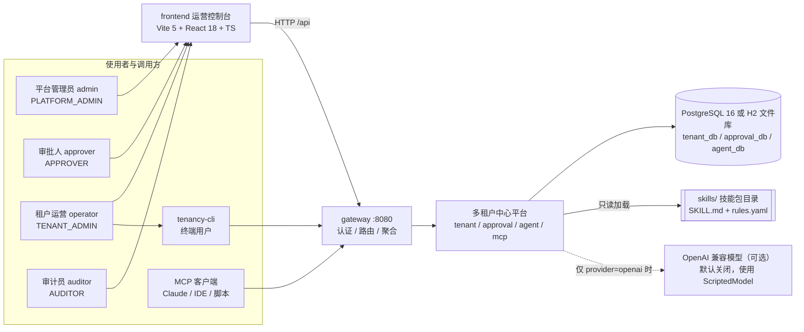

**上下文要点**

- **唯一入口是 gateway（8080）**：前端、CLI、MCP 客户端都从网关进入；网关本地处理 `/api/auth/**`、`/api/platform/**`，其余按前缀反向代理到四个后端服务。
- 认证双通道：人类/CLI 用 `Authorization: Bearer <JWT>`（HS256，网关签发，其余服务用同一 `JWT_SECRET` 验签）；机器调用用 `X-API-Key`（MCP 默认 `dev-mcp-key`）。
- 平台是**自包含离线系统**：模型是可替换的增强项，不是运行前置条件（见 §6）。

---

## 3. 逻辑架构与组件职责

### 3.1 组件图

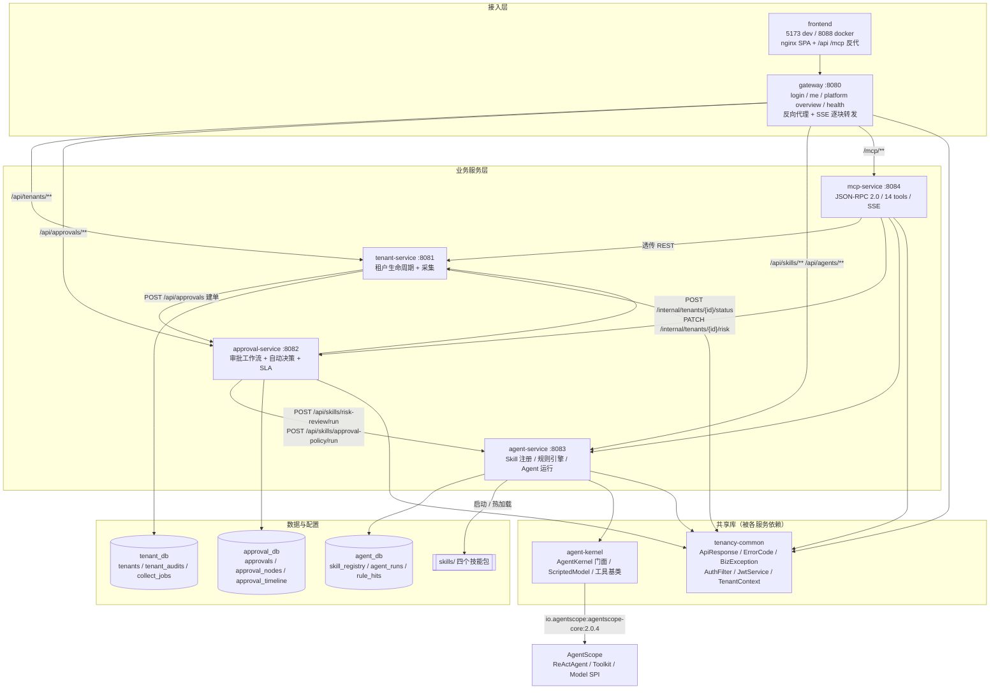

### 3.2 服务职责与边界

| 组件 | 端口 | 职责 | 数据 | 对外接口（详见 `docs/02`） |
|---|---|---|---|---|
| gateway | 8080 | JWT 签发/校验、`/api/auth/login`、`/api/auth/me`、平台聚合 `/api/platform/overview` `/api/platform/health`、反向代理、请求追踪透传、SSE 透传 | 无库；用户目录在内存（env `TENANCY_USERS`） | 认证与平台聚合接口；其余按前缀代理 |
| tenant-service | 8081 | 租户 CRUD 与状态机、提交审批、暂停/启用/注销、审计、采集（内联 records / CSV）、内部状态与风险回调 | `tenant_db` | `/api/tenants/**`、`/internal/tenants/**` |
| approval-service | 8082 | 审批单、节点与时间线、自动决策（调 Skill，失败本地兜底）、人工决策、SLA 升级、审批通过后驱动开通 | `approval_db` | `/api/approvals/**` |
| agent-service | 8083 | Skill 加载与注册（`skill_registry`）、规则引擎、4 类 Agent 运行（`agent_runs`/`rule_hits`）、工具目录 | `agent_db` | `/api/skills/**`、`/api/agents/**` |
| mcp-service | 8084 | JSON-RPC 2.0 分发（`initialize`/`ping`/`tools/*`/`resources/*`/`prompts/*`/通知）、14 个工具透传下游、SSE 流 | 无库（无状态） | `/mcp`、`/mcp/info` |
| frontend | 5173/8088 | 运营控制台 8 个页面（登录、总览、租户、采集、审批、技能、Agent、MCP） | 浏览器 localStorage 存 token | 经网关 |
| tenancy-cli | — | 命令行运维工具（auth/tenant/collect/approval/skill/agent/mcp/doctor） | `%USERPROFILE%\.tenancy\config.json` | 经网关 |

**边界规则**

1. 服务之间只走 HTTP REST，不共享数据库、不做跨库 JOIN；跨服务一致性用"状态机 + 补偿/重试"表达，不引入分布式事务。
2. `tenancy-common` 只放契约与横切能力（响应包、错误码、认证过滤器、租户上下文、CORS），不放业务逻辑。
3. `agent-kernel` 是 AgentScope 的唯一接触面：业务服务不 import `io.agentscope.*`，只依赖 `AgentKernel.Spec/Result`，便于未来替换模型或升级内核。
4. 内部接口（`/internal/**`）不对外暴露，由网关不路由该前缀 + `X-Internal-Token` 校验双重保护。

### 3.3 请求管线（横切）

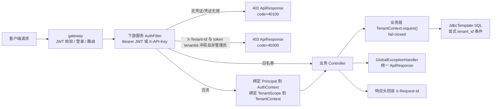

- 白名单（`tenancy.security.whitelist` 默认值）：`/actuator/health`、`/actuator/info`、`/api/auth/login`、`/error`、`/v3/api-docs/**`、`/swagger-ui/**`、`/favicon.ico`。
- 每个服务由 `TenancyCommonAutoConfiguration` 自动装配 `AuthFilter`（order=-100）、`JwtService`、`GlobalExceptionHandler`、CORS，无需模块重复实现。
- 所有响应统一 `ApiResponse{code,message,data,traceId,timestamp}`；错误码见 §8.3。

---

## 4. 核心链路

### 4.1 租户生命周期状态机

租户状态枚举（`tenants.status`，与 `docs/02` §2 完全一致）：
`DRAFT`、`SUBMITTED`、`RISK_REVIEW`、`PENDING_APPROVAL`、`APPROVED`、`PROVISIONING`、`ACTIVE`、`REJECTED`、`SUSPENDED`、`TERMINATED`。

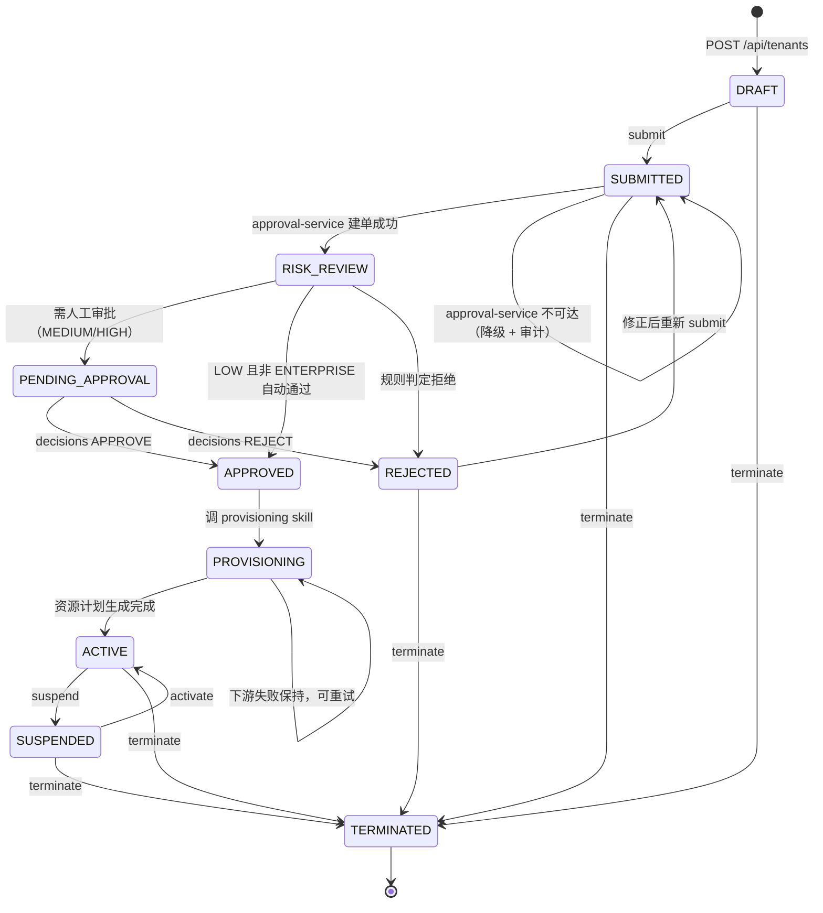

**状态机规则**

- 非法流转统一抛 `BizException(ErrorCode.APPROVAL_INVALID_STATE, ...)`（54000），HTTP 映射为 400；单据冲突/重复提交用 `CONFLICT`（40900）。
- `PUT /api/tenants/{id}` 仅允许 `DRAFT`/`REJECTED`；`suspend` 仅允许 `ACTIVE`；`activate` 仅允许 `SUSPENDED`；`terminate` 允许任意非 `TERMINATED`。
- 所有写操作落 `tenant_audits(tenant_id, at, actor, action, detail)`，审计是租户生命周期的唯一审计事实源。
- "提交"语义：`submit` 同步调用 approval-service；返回后置 `RISK_REVIEW`，审批侧再驱动到 `PENDING_APPROVAL`/`APPROVED`/`REJECTED`。

### 4.2 审批工作流状态机

审批单状态枚举（`approvals.state`，与 `docs/02` §3 一致）：
`RISK_CHECK`、`AUTO_DECISION`、`AUTO_APPROVED`、`PENDING_APPROVAL`、`APPROVED`、`REJECTED`、`PROVISIONING`、`ACTIVE`。

节点枚举（`approval_nodes.node`）：`RISK_CHECK`（AUTO）、`AUTO_DECISION`（AUTO）、`PENDING_APPROVAL`（HUMAN，L1/L2）。
节点状态：`PENDING`、`APPROVED`、`REJECTED`、`SKIPPED`；节点类型：`AUTO`、`HUMAN`。

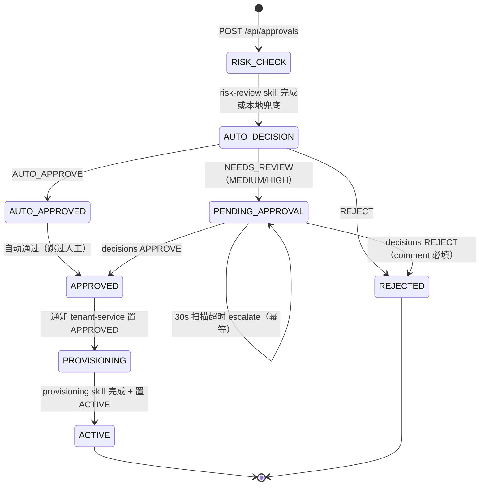

**自动决策规则**（由 `approval-policy` skill 计算，agent-service 不可达时 approval-service 本地兜底）：

- `riskLevel=LOW && plan != ENTERPRISE` → `AUTO_APPROVE`（自动通过，`auto_decided=true`，timeline 记录 `actor=agent`）；
- `riskLevel=MEDIUM` → L1 人工；
- `riskLevel=HIGH` → L2 人工 + 会签；
- `decision=REJECT`（规则显式拒绝或分数 `>= rejectMinScore`）→ 直接拒绝。

**SLA 升级**：`@Scheduled(fixedDelay=30s)` 扫描 `state=PENDING_APPROVAL AND sla_due_at < now AND escalated=false`，将 `assignee_role` 升级到上级角色并置 `escalated=true`（幂等，只升级一次），写 `approval_timeline`。

### 4.3 审批自动化主时序

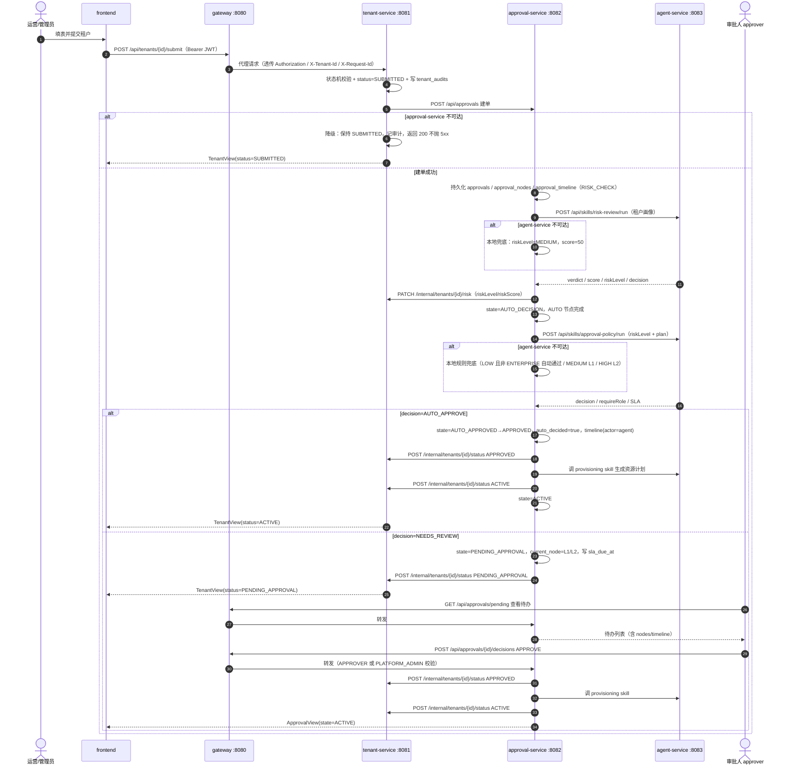

**关键失败语义**

| 场景 | 期望行为 | 依据 |
|---|---|---|
| approval-service 不可达（submit 时） | 租户保持 `SUBMITTED`，写审计，HTTP 200（不因下游故障 5xx） | `docs/02` §2 / 任务契约 |
| agent-service 不可达（自动决策） | 使用本地规则兜底：LOW 且非 ENTERPRISE 自动通过；MEDIUM→L1；HIGH→L2 | `docs/02` §3 |
| 开通下游失败 | 审批单保持 `PROVISIONING`，写 timeline，可人工/定时重试，不 5xx | `docs/02` §3 |
| 重复 escalate | `escalated=true` 幂等，不重复升级 | `docs/02` §3 |
| 决策人无权限 | `BizException(FORBIDDEN)`，403 | `docs/02` §3 |

### 4.4 租户采集链路

采集支持两种入口：内联 JSON 批量（`MANUAL_BATCH`，`POST /api/tenants/collect`）与 CSV 上传（`POST /api/tenants/collect/csv`，multipart，UTF-8，≤5MB）。任务异步执行，立即返回 `CollectJobView`。

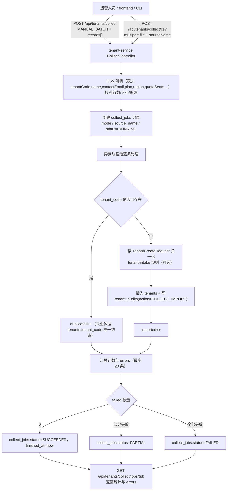

**采集约束**

- 去重键：`tenant_code`（`tenants.tenant_code` UNIQUE），重复计入 `duplicated`，不覆盖已有租户。
- 错误最多保留 20 条写入 `collect_jobs.errors_json`，避免单任务耗尽存储。
- 采集产生的租户默认 `source=IMPORT`（内联 `MANUAL` 可显式指定），`autoSubmit=true` 时逐条走提交链路。
- 采集是幂等友好而非严格幂等：同一 CSV 重复导入的第二次结果应为全部 `duplicated`。

### 4.5 MCP 拓扑

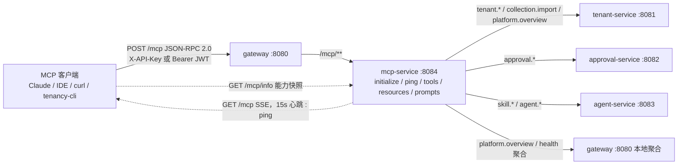

- 协议：**JSON-RPC 2.0 over HTTP**，MCP 2025-06-18 形态；`initialize` 返回 `Mcp-Session-Id`，后续请求可携带，缺失时按无状态处理。
- 方法集：`initialize`、`ping`、`tools/list`、`tools/call`、`resources/list`、`resources/read`、`prompts/list`、`prompts/get`；`notifications/*` 返回 `202 Accepted`。
- 工具 14 个，严格按 `docs/05-mcp-spec.md` §Tools 表：`tenant.create`、`tenant.list`、`tenant.get`、`tenant.submit`、`tenant.suspend`、`tenant.activate`、`collection.import`、`approval.list_pending`、`approval.get`、`approval.decide`、`skill.list`、`skill.run`、`agent.run`、`platform.overview`。
- 错误语义：协议级错误用 JSON-RPC 标准码（`-32600/-32601/-32602/-32603`）；业务失败用 `isError:true` + `structuredContent{errorCode,message}`，不抛 HTTP 500。
- 认证：`X-API-Key`（env `TENANCY_SECURITY_API_KEYS`，默认 `dev-mcp-key`）或 `Authorization: Bearer <JWT>`；MCP 响应必须回显 `X-Request-Id`，SSE 设置 `X-Accel-Buffering: no`。

**MCP 安全取舍（ADR-10）**：`X-API-Key` 是**平台级机器凭证**，等价于跨租户只读/运营能力；生产环境应替换为 OAuth2 client credentials + scope 限权。当前原型接受该风险，但要求：API Key 只通过环境变量注入、不落代码；`/mcp` 仅由网关对内网/本机暴露。

---

## 5. 数据架构

### 5.1 三库分治

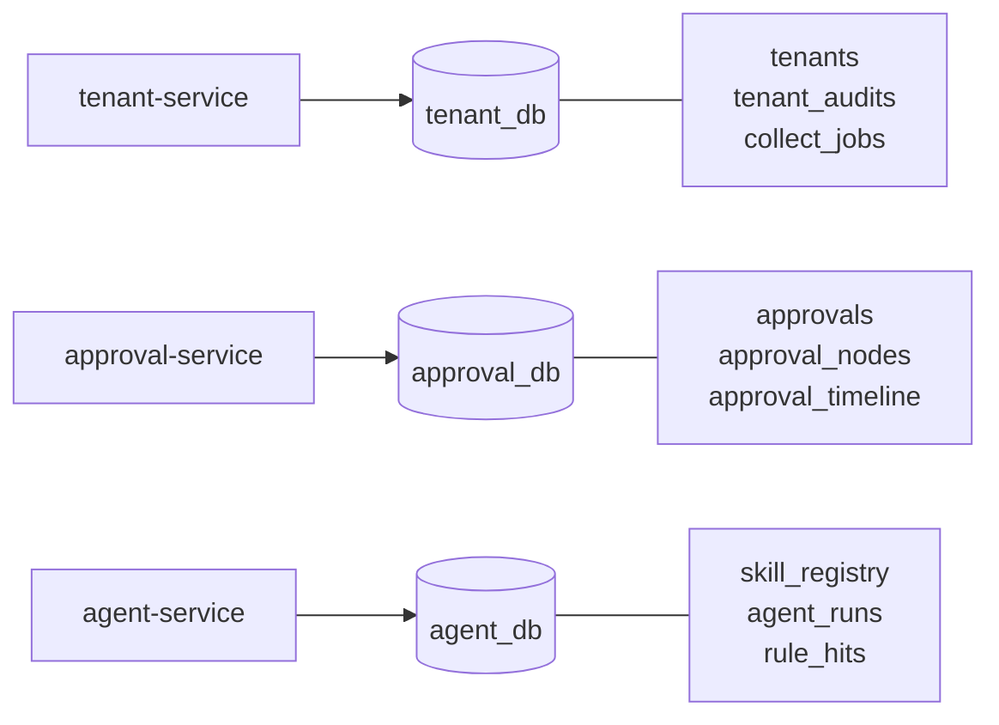

| 库 | 表 | 归属 | 迁移 |
|---|---|---|---|
| `tenant_db` | `tenants`、`tenant_audits`、`collect_jobs` | tenant-service | `tenant-service` Flyway `V1__init.sql` |
| `approval_db` | `approvals`、`approval_nodes`、`approval_timeline` | approval-service | `approval-service` Flyway `V1__init.sql` |
| `agent_db` | `skill_registry`、`agent_runs`、`rule_hits` | agent-service | `agent-service` Flyway `V1__init.sql` |

- 主键统一 `VARCHAR(36)` UUID，不使用序列，保证 H2/Postgres 双兼容；时间列 `TIMESTAMP`，应用层以 UTC 存储、对外 ISO-8601。
- 迁移 SQL 限定 ANSI 子集（`TIMESTAMP`、`BOOLEAN`、`TEXT`、`INT`、`BIGINT`），禁止 `jsonb`/`serial`/`identity` 等方言。
- `approvals`/`tenants` 带 `version BIGINT` 乐观锁，防并发覆盖。

### 5.2 一致性与事务边界

- **单库内强一致**：状态迁移、审计、节点/时间线写入在同一事务内（`@Transactional`）。
- **跨库最终一致**：审批 → 租户状态 → 开通通过 HTTP 编排；每步失败可观测（timeline/audit）且可重试；不使用分布式事务。
- **可重入**：`POST /internal/tenants/{id}/status` 对同状态幂等（重复置 `ACTIVE` 不报错、不重复写开通审计）；`escalate` 以 `escalated` 幂等。
- **不共享库**：任一服务不直读其它服务的表；跨服务只通过 API 读取。

---

## 6. Agent 架构

### 6.1 分层

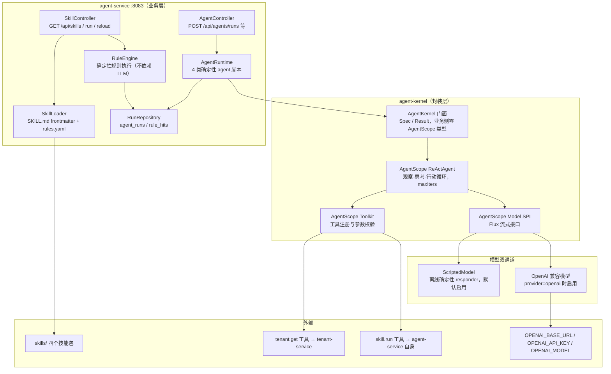

### 6.2 AgentScope 2.0.4 的使用方式

- 依赖：`io.agentscope:agentscope-core:2.0.4`（官方 Java 版，JDK 17+），只在 `agent-kernel` 模块声明；`agent-service` 依赖 `com.suhong.jiuding:agent-kernel`。
- **ReActAgent**：每类 Agent 一个 `ReActAgent` 实例（builder：`name`、`sysPrompt`、`model`、`toolkit`、`maxIters`），以 `RuntimeContext.empty()` + 单条 `UserMessage` 驱动，`block(timeout)` 取最终 `Msg.getTextContent()`。
- **Toolkit**：注册平台工具（`tenant.get`、`skill.run` 等），AgentScope 负责生成工具 schema、解析模型返回的 `ToolUseBlock`、执行工具并把 `ToolResultBlock` 回填到上下文，驱动下一轮 ReAct 迭代。
- **ScriptedModel（离线确定性）**：实现 AgentScope `Model` SPI 的 `stream(List<Msg>, List<ToolSchema>, GenerateOptions)`；按 `messages` 状态返回"先调工具、再出最终 JSON"的确定性脚本。特点：
  - 完全离线、无网络、无密钥，CI 与 docker-compose 冒烟测试可重复；
  - 产出的结构化 JSON 与真实模型同 schema，可被上层严格断言；
  - `tokensUsed` 固定（如 12/24），便于报表展示与成本估算。
- **OpenAI 兼容模型双通道**：`tenancy.agent.model.provider=openai` 时，用 `OPENAI_BASE_URL` / `OPENAI_API_KEY` / `OPENAI_MODEL` 构造真实模型（同一 `Model` SPI）；未配置则默认 scripted。业务代码不变，只换工厂。
- **确定性脚本的边界**：ScriptedModel 只用于"演示 + 测试"，不承载业务规则；所有业务判定由 §7 的规则引擎产出，避免"为了离线而把规则藏进脚本"。

### 6.3 四类 Agent 与技能/工具的映射

| agentType（`POST /api/agents/runs`） | 默认技能 | 工具调用序列 | 输出（严格 JSON 字段） |
|---|---|---|---|
| `tenant-intake` | `tenant-intake` | `tenant.get` → `skill.run(tenant-intake)` | `{valid, normalized{}, duplicates[], decision}` |
| `risk-review` | `risk-review` | `tenant.get` → `skill.run(risk-review)` | `{riskLevel, score, decision, reasons[]}` |
| `approval` | `approval-policy` | `skill.run(approval-policy)` → `approval.list_pending` | `{decision, requireRole, slaHours, rationale}` |
| `provisioning` | `provisioning` | `tenant.get` → `skill.run(provisioning)` | `{namespace, quotas{}, isolatedSchema, steps[]}` |

- Agent 运行状态：`RUNNING`、`SUCCEEDED`、`FAILED`（`agent_runs.status`）；步骤结构化入 `steps_json`，字段为 `{index, thought, action, actionInput, observation}`。
- `maxSteps` 默认 6，超出上限由 ReActAgent `maxIters` 截断并落 `FAILED`/`WARN` 审计；工具调用超时 10s（`skill.run` 透传 30s）。
- **Prompt 注入防护**：租户可控字段（名称、联系人、attributes）在注入 System Prompt 前做长度限制与 JSON 序列化包裹，不拼接自由文本；Agent 输出必须通过 JSON schema 校验后才写业务状态。

### 6.4 Agent 降级与可观测

- Agent 不可用不阻断业务：审批自动决策降级为本地规则；`risk-review` 降级为 `MEDIUM/50`。
- 每次运行持久化 `agent_runs`（`model`、`tokens_used`、`duration_ms`、`steps_json`、`output_json`）；规则命中写 `rule_hits`（`skill_id`、`rule_id`、`severity`、`matched`）。
- 前端 `/agents` 页面展示 ReAct 步骤时间线与输出 JSON；`/api/agents/tools` 暴露工具目录供 MCP/前端渲染。

---

## 7. Skill 规则引擎

### 7.1 组成与加载

- 目录：`skills/<skill-id>/SKILL.md`、`rules.yaml`、`examples/`（至少 1 组输入/期望输出，供单测引用）。
- 加载：启动时扫描 `TENANCY_SKILLS_DIR`（默认 `../skills`，docker `/app/skills`）；`POST /api/skills/reload` 热加载；元数据写 `skill_registry`（`id/name/version/type/description/manifest_raw/enabled/path/loaded_at`）。
- `SKILL.md`：YAML frontmatter 必填 `id/name/version/type/description`，可选 `triggers/tools/tags`；正文是 Agent System Prompt 片段。
- `rules.yaml`：`skillId`、`version`、`initialScore`、`rules[]`（`id/description/severity/when/then`）、`decision`（`autoApproveMaxScore`/`rejectMinScore`/`riskLevels`）。

### 7.2 执行语义（确定性，不依赖 LLM）

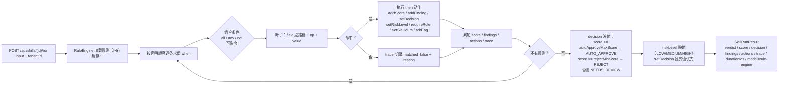

- 运算符 10 个：`eq`、`ne`、`gt`、`gte`、`lt`、`lte`、`in`、`notIn`、`contains`、`matches`；另有 `exists`、`empty` 两个存在性判断（`docs/04` 列出的完整集合）。
- 类型规则：数字按数值、布尔按布尔、其它按字符串；`exists` 只判 null/空；`matches` 用受限正则（长度 ≤256）。
- 容错：单条规则异常不中断整体，记 `trace` 且 `verdict=WARN`；`skill.run` 超过 2s 记 WARN。
- 安全：规则只读加载，禁止反射执行/脚本注入；`field` 只允许点在 input 上的白名单路径；`then.action` 枚举收敛，未知动作忽略并告警。
- 输出：`verdict`（`PASS`/`WARN`/`FAIL`）、`decision`（`AUTO_APPROVE`/`NEEDS_REVIEW`/`REJECT`/`NONE`）、`findings`、`actions`、`trace`，供审批/前端/MCP 消费。

### 7.3 内置技能包

| skill-id | type | 规则要点 |
|---|---|---|
| `tenant-intake` | INTAKE | 必填校验、邮箱/域名规范、region/plan 别名归一、重复租户识别 |
| `risk-review` | RISK | 行业、区域、配额、联系人邮箱、黑名单等 ≥6 条规则，输出 `riskLevel`/`score`/`decision` |
| `approval-policy` | APPROVAL | 由 `riskLevel+plan` 决定审批路径（自动通过 / L1 / L2 会签）、`requireRole`、SLA |
| `provisioning` | PROVISIONING | 由 `plan+isolationMode` 生成资源计划（命名空间、配额、隔离 schema 名） |

---

## 8. 多租户隔离与安全

### 8.1 隔离模型

租户隔离等级由 `tenants.isolation_mode` 表达，取值 `SHARED_SCHEMA`、`DEDICATED_SCHEMA`、`DEDICATED_DB`，默认 `SHARED_SCHEMA`。

| isolationMode | 数据布局 | 隔离强度 | 成本/复杂度 | 本期状态 |
|---|---|---|---|---|
| `SHARED_SCHEMA` | 共享表 + `tenant_id` 行隔离；应用层强制过滤 | 应用级隔离（中） | 低：一套迁移、一套连接池 | **已实现并启用** |
| `DEDICATED_SCHEMA` | 每租户独立 schema（同库） | 库内 schema 级（较高） | 中：动态 schema 路由、连接上下文、迁移分发 | 字段与命名规则预留，原型仅记录 |
| `DEDICATED_DB` | 每租户独立数据库 | 最强（物理隔离） | 高：连接池/路由/迁移/备份每租户一份 | 字段与命名规则预留，原型仅记录 |

**取舍结论**：本期以 `SHARED_SCHEMA` 交付，原因是"共享表 + 显式 `tenant_id` + fail-closed"已能满足演示需求且可直接用 H2 验证；`DEDICATED_SCHEMA`/`DEDICATED_DB` 只落 `isolation_mode` 字段与命名规则（`t_<tenant_code>` schema / `db_<tenant_code>`），不在本期实现动态数据源路由，避免为了未验证的隔离等级付出连接池与迁移复杂度。

### 8.2 fail-closed 策略（核心安全不变量）

1. **缺上下文即拒绝**：任何租户数据访问前必须 `TenantContext.require()`；缺失/空白 `tenantId` 直接抛 `BizException(UNAUTHORIZED)` → 401，**不允许**降级为"查全部"。
2. **租户头不可伪造**：`X-Tenant-Id` 与 JWT `tid` 不一致且调用方非 `PLATFORM_ADMIN`/`SYS_ADMIN` → 403（`AuthFilter.resolveTenant`）。
3. **SQL 必须显式带租户条件**：`SELECT/UPDATE/DELETE` 的 `WHERE` 必须包含 `tenant_id = ?`；仅 `PLATFORM_ADMIN` 的全量查询走独立方法（命名 `*ForPlatform`）并在评审中单列。
4. **写路径先鉴权再落库**：非平台管理员只能操作本租户；跨租户操作一律 403，不返回"对象存在但无权"的信息差异。
5. **内部接口双重保护**：`/internal/**` 不对外路由；服务间调用必须带 `X-Internal-Token`（env `TENANCY_INTERNAL_TOKEN`，默认 `dev-internal-token`），不匹配 401。
6. **MCP 同样适用**：`tools/call` 透传下游时，租户上下文以调用方凭证为准；API Key 作为平台级凭证的取舍见 ADR-10。

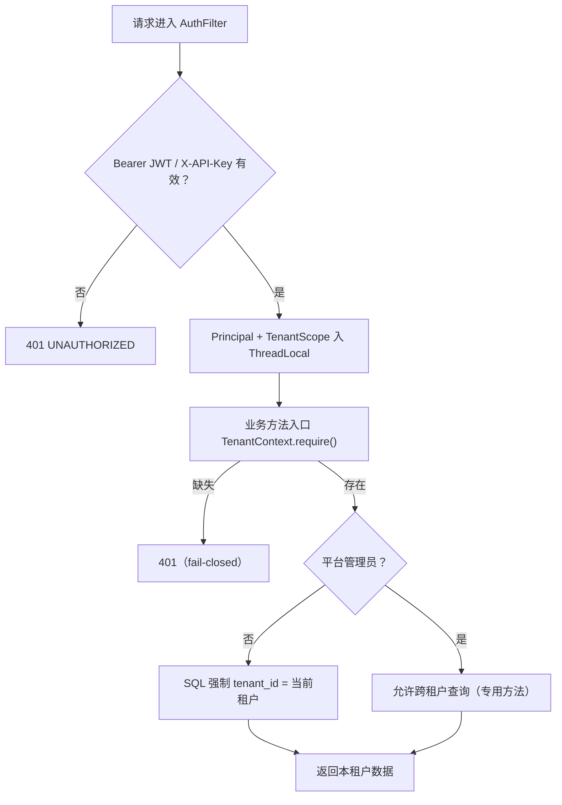

**防御纵深层次**：网关（凭证/路由）→ 服务过滤器（Principal/TenantScope）→ 业务层（require）→ SQL（显式条件）→ 数据库（tenant_code 唯一约束、外键语义由应用维护）→ 审计（tenant_audits）。

### 8.3 认证、错误码与信任边界

- JWT：HS256，`JWT_SECRET` ≥16 字符（默认 dev secret 必须在生产覆盖），TTL 120 分钟（`tenancy.security.token-ttl-minutes`）；claims：`sub/name/tid/roles/iat/exp/jti`。
- 密码：预置用户仅内存比较（`TENANCY_USERS` JSON 覆盖），原型不落库；生产应接 IdP。
- 统一错误码（`tenancy-common` `ErrorCode`）：

| 枚举 | code | HTTP | 使用场景 |
|---|---|---|---|
| `OK` | 0 | 200 | 成功 |
| `INVALID_ARGUMENT` | 40001 | 400 | 参数校验/CSV 格式 |
| `UNAUTHORIZED` | 40100 | 401 | 凭证缺失/无效/租户上下文缺失 |
| `FORBIDDEN` | 40300 | 403 | 权限不足/跨租户 |
| `TENANT_SUSPENDED` | 40301 | 403 | 已停用租户访问 |
| `NOT_FOUND` | 40400 | 404 | 资源不存在 |
| `CONFLICT` | 40900 | 409 | 唯一约束/重复提交 |
| `QUOTA_EXCEEDED` | 42900 | 429 | 配额超限 |
| `APPROVAL_INVALID_STATE` | 54000 | 400 | 状态机非法流转 |
| `AGENT_ERROR` | 53000 | 500 | Agent 运行失败 |
| `SKILL_NOT_FOUND` | 54400 | 404 | 技能不存在 |
| `UPSTREAM_ERROR` | 50200 | 502 | 下游不可达且无法降级 |
| `INTERNAL` | 50000 | 500 | 未预期异常 |

---

## 9. 部署拓扑

### 9.1 交付形态：docker-compose（用户机器执行）

本机**没有 Docker Engine 且用户非管理员**，因此 compose/Dockerfile 只能做"静态正确"交付（YAML 可解析、路径正确、健康检查命令在目标镜像内存在），不在本机执行。用户在有 Docker 的机器上执行 `docker compose up -d --build` 即可获得完整环境。

拓扑共 **7 个容器 + 2 个命名卷 = 9 个部署单元**：`postgres`、`tenant-service`、`approval-service`、`agent-service`、`mcp-service`、`gateway`、`frontend` 七个容器；`tenancy-pgdata`（数据库数据）与 `tenancy-skills`（技能包只读挂载）两个卷。

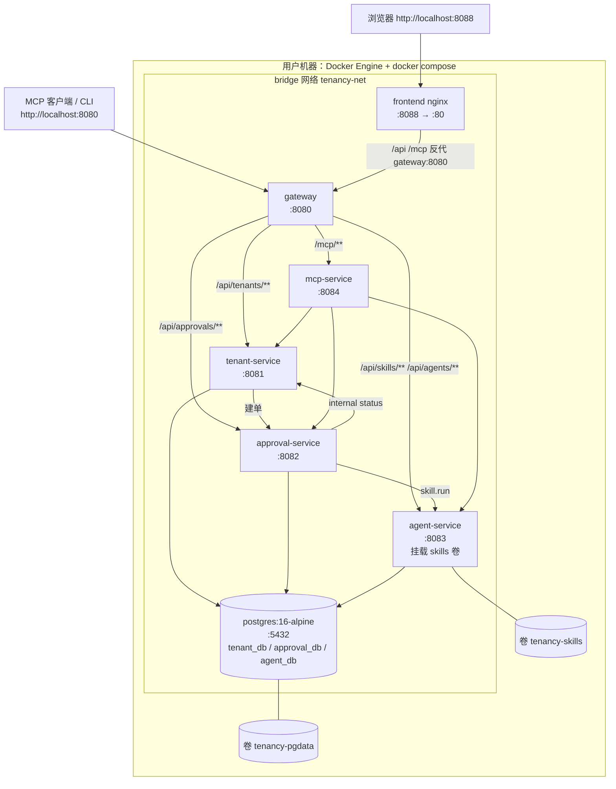

**compose 启动顺序**：`postgres`（healthy，初始化 3 库）→ `tenant-service`/`approval-service`/`agent-service`（各自 Flyway + 健康检查）→ `mcp-service` → `gateway` → `frontend`。`depends_on: condition: service_healthy` 保证就绪顺序；所有服务 `/actuator/health` 作为 HEALTHCHECK。

**端口**：宿主 `8080`（gateway）、`8088`（frontend）、`5432`（可选暴露，便于本机 psql）；容器内 `8081/8082/8083/8084` 不映射宿主，只在 `tenancy-net` 内互通。

### 9.2 本地进程拓扑（本机唯一可执行路径）

本机验证不依赖 Docker：5 个 Spring Boot 服务以 `dev` profile 启动（H2 文件库），前端 `npm run dev`，由 `scripts/run-local.ps1` 按依赖顺序后台启动并写 PID 到 `.run/`，`scripts/verify.ps1` / `tests/e2e.ps1` 做端到端验证。详细步骤、端口、排障见 `docs/06-devops.md`。

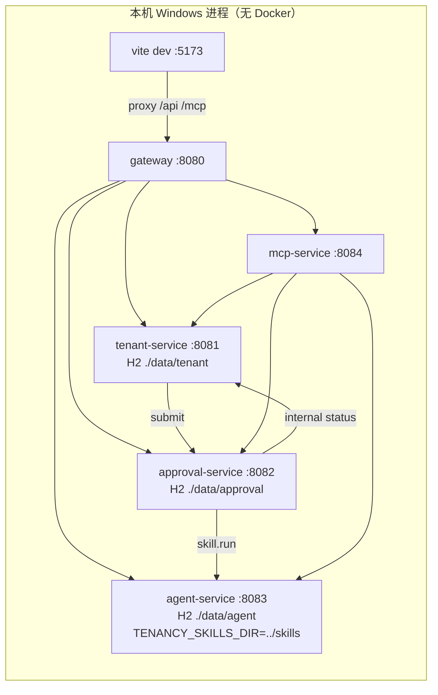

**降级说明**：本机 H2 文件库与 Docker 下 Postgres 使用同一套 Flyway 迁移；`docker` profile 只切换数据源与镜像构建，不改业务代码。

---

## 10. 关键技术决策与取舍

| ID | 决策 | 选项与取舍 | 结论 |
|---|---|---|---|
| ADR-01 | Spring Boot 3.3.5 **servlet MVC**，不用 WebFlux | WebFlux 与 JdbcTemplate/阻塞 JDBC 混用收益低；AgentScope 内部用 Reactor，但封装在 `agent-kernel`，`block()` 收口在一处 | 采用 MVC；阻塞边界可控 |
| ADR-02 | 自研 HS256 JWT（零依赖） | 引入 jjwt 需新增镜像依赖与版本管理；实现仅 100 行且可审计 | 采用自研 `JwtService`，生产必须换 IdP |
| ADR-03 | 数据访问用 **JdbcTemplate**，不用 JPA | 表结构固定、SQL 需显式 `tenant_id`（可评审）；JPA 隐式查询有越权风险 | 采用 JdbcTemplate + 显式 SQL |
| ADR-04 | AgentScope 官方 Java 库 `io.agentscope:agentscope-core:2.0.4` | 官方库保证 ReAct/Toolkit 语义与生态一致；自研 ReAct 成本高且与规范不符 | 采用官方库，封装在 `agent-kernel` |
| ADR-05 | **ScriptedModel 为默认模型** | 无网络/无密钥要求下必须离线可测；真实模型作增强 | 默认 scripted；`provider=openai` 切真实模型 |
| ADR-06 | 规则引擎**纯 Java 确定性执行**，不交给 LLM | LLM 输出不稳定、不可审计、有注入风险；规则可单测、可版本化 | 规则引擎是审批判定唯一事实源；LLM 只生成解释/摘要 |
| ADR-07 | 网关**自研代理**，不引 Spring Cloud Gateway | 只做前缀路由/聚合/SSE 透传，`java.net.http.HttpClient` 足够；避免额外响应式栈与版本冲突 | 自研轻量代理 |
| ADR-08 | 三库分治（每服务独立库/schema） | 单库共享简单但破坏服务自治；分库与 `docs/03` 一致 | 三库；不跨库 JOIN |
| ADR-09 | H2 文件库（dev）+ Postgres（docker）双 profile | 本机无 Docker，必须可离线跑；SQL 限定 ANSI 子集 | 双 profile 同迁移 |
| ADR-10 | MCP 机器调用用 `X-API-Key`（平台级） | OAuth2 需额外 IdP/网络；原型用静态 Key 简化 | 接受平台级 Key 风险，生产替换 OAuth2+scope |
| ADR-11 | MCP 协议选 2025-06-18（保留 `initialize`、兼容无状态） | 2026-07-28 无状态端点更简，但生态客户端仍普遍 `initialize` | 保留握手 + 无会话可调用 |
| ADR-12 | 采集异步线程池 + job 记录 | 同步导入会拖长请求、超时；异步需可观测 | 异步 + `collect_jobs` 状态 |
| ADR-13 | 共享 `tenancy-common` 横切，而非 BOM/框架 | 避免每个服务重复实现认证/错误码；`@AutoConfiguration` 自动装配 | 共享库，不共享业务 |
| ADR-14 | 无 Lombok、DTO 用 record | 注解处理器在离线/版本对齐场景有风险；record 天然不可变 | 采用 record |

---

## 11. 质量属性目标（原型基线）

| 属性 | 目标 | 说明 |
|---|---|---|
| 可用性 | 单服务故障不拖垮主链路 | submit 降级、自动决策兜底、网关聚合 `DOWN` 不整体失败 |
| 性能 | 登录/列表 p95 < 300ms（本机 H2）；scripted agent run < 1s；`skill.run` < 50ms | 目标值，非实测承诺 |
| 吞吐 | 50 rps 稳态（单实例、H2） | 采集 5MB CSV ≤ 2000 行，60s 内完成 |
| 可审计 | 所有租户写操作有 `tenant_audits`；审批有 `approval_timeline`；Agent 有 `agent_runs`/`rule_hits` | 审计不可关闭 |
| 可测试 | 每个服务纯单测 + MockMvc 契约测试；E2E 覆盖 `docs/02` §6 七步 | 见 `docs/07-test-plan.md` |
| 可移植 | 本地进程 / Docker Compose 两套路径同代码 | 见 `docs/06-devops.md` |

**限制**：CSV ≤5MB、采集错误 ≤20 条、ReAct `maxIters` 默认 6、`tools/call` 10s、`skill.run` 30s、Agent 单次 60s、审批 SLA 默认 L1 24h / L2 48h（由 skill 配置覆盖）。

---

## 12. 风险清单

| ID | 风险 | 影响 | 概率 | 应对措施 |
|---|---|---|---|---|
| R-01 | **AgentScope 2.0.4 与 Spring Boot 3.3.5 的 Jackson/Reactor 版本对齐 + 工具调用契约（已修复）**：`agentscope-core` POM 声明 reactor-core 3.8.2、jackson-databind 2.21.x，而 Boot 3.3.5 的 dependencyManagement 会将其收敛到 reactor 3.6.x、Jackson 2.17.x；曾因 `ToolUseBlock` 未携带 `content`（参数 JSON 字符串），ReAct 循环解析不到工具入参，报"未找到所需属性 `text`" | 已消除：工具调用链路恢复（ReActAgent→工具执行→ToolResult→最终答案），`/api/agents/**` 与 Skill 工具链可用 | 已修复（原中高） | **根因**：AgentScope ReAct 循环从 `ToolUseBlock.content`（参数 JSON 字符串）解析并校验工具参数，只给 `input` Map 时被判定为无参数。**修复**：① `ScriptedModel.toolCall` 用 Jackson 将 `input` 序列化为 JSON 写入 `content`；② 新增 `FunctionTool implements AgentTool`（JSON 入/JSON 出，`FunctionTool.schema(...)` + `ParamSpec` 声明参数），`AgentKernel` 增加 `agentTool(...)` 与 `toolkit.registerAgentTool(...)` 注册路径，绕开反射 `@Tool` 参数绑定，便于按 Skill manifest 动态生成工具。**证据**：`agent-kernel` spike 2 个测试全绿（2026-11-08 00:14 实测；surefire 报告 00:17，`Tests run: 2, Failures: 0, Errors: 0`）；依赖保持 Boot 3.3.5 管理版本，未升级 Boot。**回归**：升级 AgentScope 或新增工具时重跑 spike 与 `docs/07` TC-AGT-* |
| R-02 | **无 Docker 验证盲区**：本机无法执行 compose，Dockerfile/健康检查/初始化脚本只能静态检查 | 交付到用户机器可能启动失败（路径、健康检查命令、卷权限） | 中 | YAML 解析 + Dockerfile 人工评审 + `deploy/README` 固化命令；H2 dev 路径覆盖全部业务逻辑；用户机器首次 `docker compose up` 作为验收门 |
| R-03 | **LLM 依赖与非确定性**：开启 OpenAI 通道后需要网络/密钥，输出可能不稳定、有成本与数据出境问题 | 演示环境失效、审批判定不可复现 | 中 | 默认 ScriptedModel；真实模型仅作可选开关；业务判定由规则引擎负责，LLM 不参与最终决策；超时与重试有上限 |
| R-04 | **多租户数据泄漏**：新代码漏加 `tenant_id`、`TenantContext` 未绑定、平台管理员分支过宽 | 跨租户越权，P0 | 中 | fail-closed + `docs/08` 专项 checklist + 隔离单测（A 租户读不到 B 租户）+ 代码评审阻断项 |
| R-05 | **认证/授权绕过**：白名单过宽、内部接口暴露、`X-Internal-Token` 默认值上生产、JWT secret 未覆盖 | 未授权访问 | 中 | 白名单最小化；网关不路由 `/internal/**`；启动日志 WARN 默认密钥；生产 checklist 强制覆盖 |
| R-06 | **性能与容量**：H2 文件库并发写锁、Postgres 单实例、采集线程池无界、审批 30s 扫描全表 | 高峰超时/任务堆积 | 中 | 线程池有界队列；分页接口强制上限；SLA 扫描加索引 `idx_approvals_state`；H2 仅 dev |
| R-07 | **H2/Postgres 方言漂移**：迁移脚本使用方言函数或大小写差异，`docker` profile 启动失败 | 容器环境不可用 | 中 | 迁移限定 ANSI 子集；双 profile 启动冒烟（用户机器）；`docs/07` 含 compose 静态校验 |
| R-08 | **MCP 协议演进**：2026-07-28 无状态修订与 2025-06-18 形态差异、SSE 在 nginx 下被缓冲 | 第三方客户端不兼容/流式失效 | 低中 | 保留 `initialize` 且无会话可用；SSE 设 `X-Accel-Buffering: no`；`/mcp/info` 暴露能力快照 |
| R-09 | **分布式一致性**：审批通过后租户状态/开通失败，产生 `PROVISIONING` 悬挂 | 数据不一致、需人工介入 | 中 | 状态机 + timeline + 重试接口；幂等 internal status；失败不 5xx |
| R-10 | **Agent 工具调用参数契约**：AgentScope schema 校验与脚本输入不一致（已在本机 spike 复现） | Agent 运行失败率 | 中 | 工具入参统一走显式 `Map<String,Object>` + 固定 schema；单测覆盖工具调用；失败降级为规则结果 |
| R-11 | **安全横向移动**：服务间 HTTP 明文 + 静态 internal token、`X-Request-Id` 可伪造 | 内网可被冒充 | 低中 | 容器网络隔离；internal token 走环境变量；生产启用 mTLS/网关前置 |

---

## 13. 演进路线

1. **隔离升级**：实现 `DEDICATED_SCHEMA` 的动态 schema 路由（`tenant_code → schema` 映射表），再演进到 `DEDICATED_DB` 的连接池路由。
2. **身份体系**：JWT 保留为边缘凭证，接入 OIDC/IdP，MCP 改 OAuth2 client credentials + scope。
3. **Agent 能力**：接入真实 OpenAI 兼容模型与 RAG；把 `risk-review` 的知识沉淀为可版本化规则包，LLM 只做解释与摘要。
4. **可观测性**：`traceId` 全链路贯通（网关 → 服务 → 下游）、指标（Micrometer）与审计看板。
5. **生产化部署**：K8s + Helm，Postgres 高可用，密钥管理（Vault/KMS），限流熔断。

---

## 14. 附录：契约索引（与 02/03/04/05 对照）

### 14.1 接口索引

| 所属 | 接口 | 说明 |
|---|---|---|
| gateway | `POST /api/auth/login`、`GET /api/auth/me` | 登录/当前用户 |
| gateway | `GET /api/platform/overview`、`GET /api/platform/health` | 平台聚合与健康 |
| tenant-service | `POST/GET/PUT /api/tenants`、`GET /api/tenants/{id}` | 租户 CRUD |
| tenant-service | `POST /api/tenants/{id}/submit`、`/suspend`、`/activate`、`/terminate` | 生命周期动作 |
| tenant-service | `GET /api/tenants/{id}/audits`、`GET /api/tenants/overview` | 审计/总览 |
| tenant-service | `POST /api/tenants/collect`、`POST /api/tenants/collect/csv`、`GET /api/tenants/collect/jobs` | 采集 |
| tenant-service | `GET /internal/tenants/{id}`、`POST /internal/tenants/{id}/status`、`PATCH /internal/tenants/{id}/risk` | 内部接口（`X-Internal-Token`） |
| approval-service | `POST/GET /api/approvals`、`GET /api/approvals/pending`、`GET /api/approvals/{id}` | 审批单 |
| approval-service | `POST /api/approvals/{id}/decisions`、`POST /api/approvals/{id}/escalate`、`GET /api/approvals/overview` | 决策/升级/总览 |
| agent-service | `GET /api/skills`、`GET /api/skills/{id}`、`POST /api/skills/reload`、`POST /api/skills/{id}/run` | Skill |
| agent-service | `POST /api/agents/runs`、`GET /api/agents/runs/{runId}`、`GET /api/agents/runs`、`GET /api/agents/tools`、`GET /api/agents/overview` | Agent |
| mcp-service | `POST /mcp`、`GET /mcp`（SSE）、`GET /mcp/info` | MCP |

### 14.2 表索引

`tenants`、`tenant_audits`、`collect_jobs`（tenant_db）；`approvals`、`approval_nodes`、`approval_timeline`（approval_db）；`skill_registry`、`agent_runs`、`rule_hits`（agent_db）。

### 14.3 枚举索引

- 租户状态：`DRAFT/SUBMITTED/RISK_REVIEW/PENDING_APPROVAL/APPROVED/PROVISIONING/ACTIVE/REJECTED/SUSPENDED/TERMINATED`
- 审批状态：`RISK_CHECK/AUTO_DECISION/AUTO_APPROVED/PENDING_APPROVAL/APPROVED/REJECTED/PROVISIONING/ACTIVE`
- 计划：`FREE/PRO/ENTERPRISE`；风险：`LOW/MEDIUM/HIGH`；决策：`AUTO_APPROVE/NEEDS_REVIEW/REJECT/NONE`；verdict：`PASS/WARN/FAIL`
- 隔离：`SHARED_SCHEMA/DEDICATED_SCHEMA/DEDICATED_DB`；Agent 类型：`tenant-intake/risk-review/approval/provisioning`；运行状态：`RUNNING/SUCCEEDED/FAILED`
