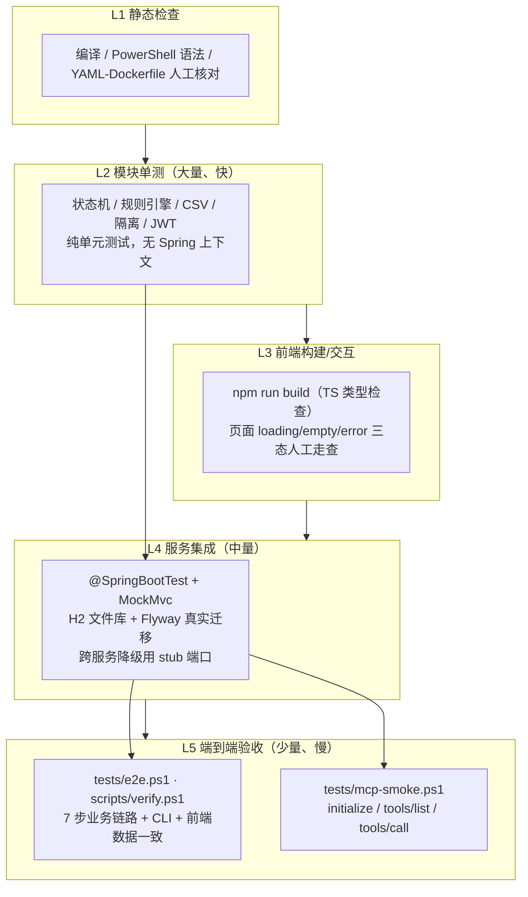

# 07 · 测试计划与验收标准

> 本计划覆盖多租户中心平台从单元测试到端到端验收的全部验证活动，与 `docs/02-api-contracts.md` §6 的关键链路、`docs/04-skill-spec.md` 的规则语义、`docs/05-mcp-spec.md` 的协议要求一一对应。架构背景见 `docs/01-architecture.md`，运行命令见 `docs/06-devops.md`。

---

## 1. 测试目标与质量门禁

### 1.1 目标

1. 证明 5 个服务 + 网关 + 前端 + CLI 在**无 Docker、无外网、无 LLM**的本机环境可构建、可启动、可验收。
2. 证明多租户隔离是 **fail-closed** 的：缺租户上下文拒绝、跨租户访问 403、平台管理员可跨租户。
3. 证明审批自动化在**下游不可达**时按契约降级（不 5xx、状态可解释、可重试）。
4. 证明 Agent/Skill 是**确定性可测**的：规则引擎输出可断言，ScriptedModel 产出合法 JSON，ReAct 步骤可回放。
5. 证明 MCP 协议面满足 2025-06-18 形态：14 个工具、JSON-RPC 错误码、SSE 心跳。

### 1.2 质量门禁（合并/验收阻断条件）

| 门禁 | 标准 | 执行者 |
|---|---|---|
| G1 编译 | `mvn -B -DskipTests install` 全模块 `BUILD SUCCESS` | 各模块负责人 |
| G2 单测 | 每个服务 `mvn -f <module>/pom.xml test` 通过，`Failures=0, Errors=0` | 各模块负责人 |
| G3 契约测试 | MockMvc 覆盖核心接口 JSON 结构（字段齐全、`code=0`、错误码正确） | 各模块负责人 |
| G4 前端构建 | `npm run build` 成功、`dist/` 生成、无 TS 错误 | web |
| G5 E2E | `scripts/verify.ps1` / `tests/e2e.ps1` 输出 PASS（7/7） | cli-devops + Lead |
| G6 MCP 协议 | `tests/mcp-smoke.ps1` 输出 PASS（3/3） | cli-devops |
| G7 脚本/配置静态正确 | `.ps1` 语法检查通过；compose/Dockerfile 人工核对（本机无 Docker） | cli-devops + architect |
| G8 评审 | `docs/08-code-review.md` checklist 全部通过 | Lead + architect |

**已知问题状态**：§8 AG-KRN-01（AgentScope 工具参数校验失败）已由 Lead 修复——根因是 `ToolUseBlock` 缺少 `content`（参数 JSON 字符串），修复为 `ScriptedModel.toolCall` 写入 `content` 并新增 `FunctionTool implements AgentTool` 的注册路径；`AgentKernelSpikeTest` 2 个用例全绿（2026-11-08 00:14 实测），不再阻断 G2/G5，记录保留作为回归基线。

---

## 2. 测试金字塔



| 层 | 范围 | 数量目标 | 运行时间 | 依赖 |
|---|---|---|---|---|
| L1 静态 | 编译、脚本语法、配置一致性 | 全量 | < 3 min | 无 |
| L2 单测 | 每模块 ≥4 个测试类（agent-service ≥5） | ≥ 30 个测试类 | < 5 min | 无网络 |
| L3 前端 | `tsc` + `vite build` + 三态走查 | 1 次构建 + 8 页面 | < 3 min | 无 |
| L4 集成 | Spring 上下文 + MockMvc + H2 | 每服务 ≥3 个契约用例 | < 10 min | 本机进程 |
| L5 E2E | 7 步链路 + MCP + CLI | 7 + 3 用例 | < 5 min | 全栈启动 |

---

## 3. 用例矩阵

> 约定：`ID` 前缀表示模块；`级别` 为 L2/L4/L5；`自动化` 表示是否有脚本/测试类承载。

### 3.1 公共库与技术横切（tenancy-common / gateway）

| ID | 场景 | 输入/步骤 | 期望 | 级别 | 自动化 |
|---|---|---|---|---|---|
| TC-COM-01 | `ApiResponse` 成功包 | `ok(data)` | `code=0,message=ok,data=...,timestamp` 非空 | L2 | 是 |
| TC-COM-02 | `ApiResponse` 失败包 | `error(40100,...)` | `code=40100,message,data=null` | L2 | 是 |
| TC-COM-03 | JWT 签发/解析 | 签发后解析 | `sub/tid/roles` 一致，`exp` 有效 | L2 | 是 |
| TC-COM-04 | JWT 篡改 | 修改 payload | `UNAUTHORIZED`（40100） | L2 | 是 |
| TC-COM-05 | JWT 过期 | 过期 token | `UNAUTHORIZED` | L2 | 是 |
| TC-COM-06 | 缺少凭证 | 无 Authorization/API-Key | 401 ApiResponse（非 HTML 错误页） | L4 | 是 |
| TC-COM-07 | 白名单放行 | `GET /actuator/health` | 200，无凭证也可访问 | L4 | 是 |
| TC-COM-08 | 租户头与 token 不一致 | operator token + `X-Tenant-Id: t-other` | 403（40300） | L4 | 是 |
| TC-COM-09 | 平台管理员跨租户 | admin token + 任意 `X-Tenant-Id` | 200 | L4 | 是 |
| TC-COM-10 | 无租户上下文 fail-closed | 直接调用需要租户的 Service 方法 | `BizException(UNAUTHORIZED)` | L2 | 是 |
| TC-GW-01 | 登录成功 | `admin/Admin@123` | 200，`token/tokenType/expiresIn/principal.roles` | L4 | 是 |
| TC-GW-02 | 登录失败 | 错误密码 | 401，`code=40100` | L4 | 是 |
| TC-GW-03 | 代理转发 | 起 stub 端口，`GET /api/tenants?page=0` | 透传 Authorization/X-Tenant-Id/X-Request-Id；响应回显 `X-Request-Id` | L4 | 是 |
| TC-GW-04 | 聚合降级 | 某下游不可达 | `/api/platform/health` 200，对应项 `status=DOWN`，整体不 5xx | L4 | 是 |
| TC-GW-05 | 登录后 `/api/auth/me` | 带 token | principal 与登录返回一致 | L4 | 是 |

### 3.2 tenant-service（8081）

| ID | 场景 | 步骤 | 期望 | 级别 | 自动化 |
|---|---|---|---|---|---|
| TC-TEN-01 | 创建租户 | `POST /api/tenants`（autoSubmit=false） | 200，`status=DRAFT`，`tenantCode` 回显 | L4 | 是 |
| TC-TEN-02 | 创建参数非法 | 空 `tenantCode`、非法邮箱 | 400，`code=40001` | L4 | 是 |
| TC-TEN-03 | 租户编码唯一 | 重复 `tenantCode` | 409，`code=40900` | L4 | 是 |
| TC-TEN-04 | 查询分页/过滤 | `?status=DRAFT&plan=PRO&page=0&size=20` | 只返回匹配项，`PageResult` 字段齐全 | L4 | 是 |
| TC-TEN-05 | 更新仅 DRAFT/REJECTED | 对 ACTIVE 调 `PUT` | 400，`code=54000` | L2/L4 | 是 |
| TC-TEN-06 | 提交（正常） | `POST /submit`，approval stub 成功 | 200，`status=RISK_REVIEW`，`submitted_at` 非空 | L4 | 是 |
| TC-TEN-07 | 提交（审批服务不可达） | approval stub 返回 503/拒绝连接 | 200，`status=SUBMITTED`，`tenant_audits` 新增降级记录 | L4 | 是 |
| TC-TEN-08 | 非法流转 | `ACTIVE` 直接 `submit` | 400，`code=54000` | L2/L4 | 是 |
| TC-TEN-09 | 停用/启用 | ACTIVE→`suspend`→SUSPENDED→`activate`→ACTIVE | 状态流转正确，审计两条 | L4 | 是 |
| TC-TEN-10 | 注销 | 任意非 TERMINATED → `terminate` | 200，`status=TERMINATED`；再次 terminate 400 | L4 | 是 |
| TC-TEN-11 | 审计时间线 | 创建+提交+停用后 `GET /audits` | 至少 3 条，字段 `{at,actor,action,detail}` | L4 | 是 |
| TC-TEN-12 | 采集内联批量 | `POST /api/tenants/collect` 3 条（含 1 重复） | `imported=2,duplicated=1,failed=0`，job `SUCCEEDED` | L4 | 是 |
| TC-TEN-13 | CSV 采集 | multipart 表头 `tenantCode,name,contactEmail,plan,region,quotaSeats` | 解析成功，计数正确，UTF-8 中文不乱码 | L4 | 是 |
| TC-TEN-14 | CSV 超限/坏格式 | >5MB 或缺失表头 | 400，`code=40001`，不产生 job 或 job `FAILED` | L4 | 是 |
| TC-TEN-15 | 采集失败部分成功 | 5 条中 2 条非法 | `status=PARTIAL`，`errors` ≤20 条 | L4 | 是 |
| TC-TEN-16 | 采集去重语义 | 同批 CSV 连续导入两次 | 第二次全部 `duplicated`，不覆盖已有租户 | L2 | 是 |
| TC-TEN-17 | 租户隔离 | operator（t-acme）查询/读取非本租户 | 403（40300），不泄漏数据 | L4 | 是 |
| TC-TEN-18 | 内部接口 token 校验 | 无 `X-Internal-Token` 调用 `/internal/tenants/{id}` | 401 | L4 | 是 |
| TC-TEN-19 | 内部状态回调 | `POST /internal/tenants/{id}/status APPROVED` | 状态合法流转；同值重复调用幂等 | L4 | 是 |
| TC-TEN-20 | 总览 | `GET /api/tenants/overview` | `{total,byStatus,byPlan,byRisk,active,pending}` 字段齐全 | L4 | 是 |

### 3.3 approval-service（8082）

| ID | 场景 | 步骤 | 期望 | 级别 | 自动化 |
|---|---|---|---|---|---|
| TC-APP-01 | 建单 | `POST /api/approvals` | 200，`state=RISK_CHECK`，nodes 含 RISK_CHECK/AUTO_DECISION | L4 | 是 |
| TC-APP-02 | 自动决策（LOW/非 ENTERPRISE） | agent stub 返回 AUTO_APPROVE | `state=AUTO_APPROVED`，`autoDecided=true`，timeline `actor=agent` | L4 | 是 |
| TC-APP-03 | 自动决策（MEDIUM） | agent stub NEEDS_REVIEW | `state=PENDING_APPROVAL`，`currentNode=L1`，`slaDueAt` 非空 | L4 | 是 |
| TC-APP-04 | 自动决策（HIGH） | agent stub NEEDS_REVIEW + HIGH | `currentNode=L2`，会签标记存在 | L4 | 是 |
| TC-APP-05 | agent-service 不可达 | stub 拒绝连接 | 本地兜底规则生效，接口不 5xx | L4 | 是 |
| TC-APP-06 | 人工通过 | approver 决策 APPROVE | `state=APPROVED→PROVISIONING→ACTIVE`（下游 stub 成功） | L4 | 是 |
| TC-APP-07 | 人工驳回必须写意见 | REJECT + 空 comment | 400，`code=40001` | L4 | 是 |
| TC-APP-08 | 权限校验 | operator/auditor 决策 | 403，`code=40300` | L4 | 是 |
| TC-APP-09 | 非法流转 | 对 ACTIVE 单再次 decisions | 400，`code=54000` | L2 | 是 |
| TC-APP-10 | SLA 升级幂等 | 构造超时 PENDING 单，调度两次 | 第一次 `escalated=true` 并升级；第二次无重复升级 | L2 | 是 |
| TC-APP-11 | 分页/状态过滤 | `GET /api/approvals?state=PENDING_APPROVAL&page=0` | 仅返回匹配单，`PageResult` 完整 | L4 | 是 |
| TC-APP-12 | 待办接口 | `GET /api/approvals/pending` | 返回列表且不含已决单 | L4 | 是 |
| TC-APP-13 | 下游失败保持 PROVISIONING | provisioning stub 失败 | 状态停 `PROVISIONING`，timeline 记录，接口不 5xx；重试可推进 | L4 | 是 |
| TC-APP-14 | 总览 | `GET /api/approvals/overview` | `{pending,autoApproved,approved,rejected,slaBreached}` | L4 | 是 |

### 3.4 agent-service + skills（8083）

| ID | 场景 | 步骤 | 期望 | 级别 | 自动化 |
|---|---|---|---|---|---|
| TC-AGT-01 | Skill 加载 | 启动扫描 `skills/` | 4 个技能包注册成功，`skill_registry` 4 行，frontmatter 字段完整 | L4 | 是 |
| TC-AGT-02 | 热加载 | `POST /api/skills/reload` | `{reloaded:4,skills:[...]}`，非法目录不崩溃 | L4 | 是 |
| TC-AGT-03 | 组合条件 `all/any/not` | 嵌套规则输入 | 命中/不命中符合预期，`trace` 记录每条 `matched` | L2 | 是 |
| TC-AGT-04 | 10 个运算符 | `eq/ne/gt/gte/lt/lte/in/notIn/contains/matches` | 逐项断言；`matches` 超长正则被拒 | L2 | 是 |
| TC-AGT-05 | 决策映射 | score 边界（=20、=60、=80） | `AUTO_APPROVE/NEEDS_REVIEW/REJECT` 正确；`setDecision` 优先 | L2 | 是 |
| TC-AGT-06 | 单规则异常不中断 | 某规则字段缺失/类型错误 | 整体继续执行，`verdict=WARN`，trace 有记录 | L2 | 是 |
| TC-AGT-07 | risk-review 规则覆盖 | 行业/区域/配额/邮箱/黑名单样例 | ≥6 条规则可命中，`riskLevel/score/decision` 合理 | L2 | 是 |
| TC-AGT-08 | approval-policy 输出 | LOW/MEDIUM/HIGH × plan | 输出 `decision/requireRole/slaHours` 与预期一致 | L2 | 是 |
| TC-AGT-09 | provisioning 输出 | plan × isolationMode | 输出资源计划 JSON（namespace/quotas/isolatedSchema） | L2 | 是 |
| TC-AGT-10 | Agent 运行（scripted） | `POST /api/agents/runs` 4 类 agentType | `status=SUCCEEDED`，output 为合法 JSON，steps 含 thought/action/observation | L4 | 是 |
| TC-AGT-11 | Agent 运行（maxSteps 超限） | `maxSteps=1` 且脚本需 2 步 | 终止并按契约落 `FAILED`/截断，不挂起 | L4 | 是 |
| TC-AGT-12 | OpenAI 通道未配置 | `provider=openai` 但无 key | 启动/运行时明确报错或回退 scripted（按实现契约），不影响其它接口 | L2 | 是 |
| TC-AGT-13 | 工具目录 | `GET /api/agents/tools` | 返回 `name/description/parameters(JSON Schema)` | L4 | 是 |
| TC-AGT-14 | 运行查询/分页 | `GET /api/agents/runs?agentType=risk-review` | 返回该类型运行，`PageResult` 完整 | L4 | 是 |
| TC-AGT-15 | 模型标识 | scripted 运行 | `model` 字段非空（如 `scripted-*`），`tokensUsed>=0` | L4 | 是 |
| TC-AGT-16 | 内置技能包结构 | 检查 `skills/*/SKILL.md` | 4 包齐全，frontmatter 必填字段存在，每包有 `examples/` | L2 | 是 |

### 3.5 mcp-service（8084）

| ID | 场景 | 步骤 | 期望 | 级别 | 自动化 |
|---|---|---|---|---|---|
| TC-MCP-01 | initialize | `POST /mcp` `initialize` | `protocolVersion=2025-06-18`，capabilities/serverInfo/instructions 齐全，返回 `Mcp-Session-Id` | L4 | 是 |
| TC-MCP-02 | ping | `ping` | `result={}` | L4 | 是 |
| TC-MCP-03 | tools/list | `tools/list` | 14 个工具，名称与 `docs/05` 完全一致，每个含 inputSchema | L4 | 是 |
| TC-MCP-04 | tools/call 成功 | `tenant.list` | `isError=false`，`content[0].type=text`，`structuredContent` 有数据 | L4 | 是 |
| TC-MCP-05 | tools/call 下游失败 | 下游 stub 500/超时 | `isError=true`，`structuredContent.errorCode/message`，HTTP 非 500 | L4 | 是 |
| TC-MCP-06 | 未知方法 | `unknown/method` | JSON-RPC `-32601` | L4 | 是 |
| TC-MCP-07 | 参数非法 | `tools/call` 缺 `name` | `-32602` | L4 | 是 |
| TC-MCP-08 | API Key 校验 | 无/错误 `X-API-Key` | 401；正确 key 200 | L4 | 是 |
| TC-MCP-09 | SSE | `GET /mcp` + `Accept: text/event-stream` | `text/event-stream`，15s 内出现 `: ping` 注释，`X-Accel-Buffering: no` | L4 | 是 |
| TC-MCP-10 | 通知 | `notifications/initialized` | 202 空响应 | L4 | 是 |
| TC-MCP-11 | resources/prompts | `resources/list`、`resources/read`、`prompts/list`、`prompts/get` | 4 resources / 2 prompts，与 `docs/05` 一致 | L4 | 是 |
| TC-MCP-12 | `/mcp/info` | `GET /mcp/info` | `{server,protocolVersion,tools,resources,prompts,apiKeyRequired}` | L4 | 是 |
| TC-MCP-13 | X-Request-Id 回显 | 带 `X-Request-Id` 调用 | 响应头回显同值 | L4 | 是 |

### 3.6 前端（frontend）

| ID | 场景 | 步骤 | 期望 | 级别 | 自动化 |
|---|---|---|---|---|---|
| TC-FE-01 | 依赖安装 | `npm ci`（npmmirror） | 成功，无网络外网依赖 | L3 | 是 |
| TC-FE-02 | 类型检查/构建 | `npm run build` | `tsc` 无错误，`dist/index.html` + assets 生成 | L3 | 是 |
| TC-FE-03 | 登录与路由守卫 | 错误密码/未登录访问 `/tenants` | 错误提示；未登录跳 `/login` | L3 | 人工 |
| TC-FE-04 | 8 个页面 | 登录后逐页访问 | 均渲染，无控制台错误，中文界面 | L3 | 人工 |
| TC-FE-05 | 三态 | 断网/无数据/正常 | loading/empty/error 均可见 | L3 | 人工 |
| TC-FE-06 | 写操作 | 新建租户/提交/审批/CSV 上传 | 结果与后端一致，401 自动跳登录 | L5 | 人工 + E2E 数据核对 |
| TC-FE-07 | 响应式 | 1280px 及以上 | 布局不溢出、表格可横向滚动 | L3 | 人工 |
| TC-FE-08 | nginx.conf | 静态检查 SPA fallback + `/api` `/mcp` 反代 | 配置项齐全（供 Docker 使用） | L1 | 人工 |

### 3.7 CLI 与运维脚本

| ID | 场景 | 步骤 | 期望 | 级别 | 自动化 |
|---|---|---|---|---|---|
| TC-CLI-01 | 参数解析 | `tenancy tenant list --page 0 --output json` | 解析正确，输出纯 JSON `data` | L2 | 是 |
| TC-CLI-02 | 退出码 | 成功/参数错/认证失败/业务错/网络错 | `0/2/3/4/5` 精确映射 | L2 | 是 |
| TC-CLI-03 | 表格渲染 | 中英文混排 | 列对齐，宽度计算正确 | L2 | 是 |
| TC-CLI-04 | 配置读写 | `auth login` 后读 `%USERPROFILE%\.tenancy\config.json` | token 落盘，格式正确 | L2 | 是 |
| TC-CLI-05 | doctor | 网关与各服务状态 | 输出可达性清单，异常项非 0 退出 | L5 | 是 |
| TC-OPS-01 | PowerShell 语法 | §7.2 解析全部 `.ps1` | 无 parse error | L1 | 是 |
| TC-OPS-02 | compose 静态检查 | 人工核对 + 文本扫描 | 7 容器、端口 8080/8088、`depends_on: service_healthy`、卷/网络齐全 | L1 | 人工 |
| TC-OPS-03 | Dockerfile 静态检查 | `Select-String FROM/USER/HEALTHCHECK` | 多阶段、非 root、HEALTHCHECK 存在且命令在镜像内可用 | L1 | 人工 |
| TC-OPS-04 | 本地启动/停止 | `run-local.ps1` → `stop-local.ps1` | 5 服务 + 前端起停正常，PID 清理干净，可重复执行 | L5 | 是 |

---

## 4. E2E 验收链路（对应 `docs/02` §6）

| 步骤 | 请求 | 断言 | 失败判定 |
|---|---|---|---|
| E2E-01 登录 | `POST /api/auth/login` `admin/Admin@123` | 200，`code=0`，`data.token` 非空，`principal.roles` 含 `PLATFORM_ADMIN` | 非 200 或 token 空 |
| E2E-02 建租户 | `POST /api/tenants`（autoSubmit=false，`tenantCode=e2e-<ts>`，`plan=PRO`） | 200，`status=DRAFT`，返回 `id` | 状态非 DRAFT |
| E2E-03 提交 | `POST /api/tenants/{id}/submit` | 200；`status ∈ {RISK_REVIEW,PENDING_APPROVAL,ACTIVE}`（阈值/风险由规则决定）；approval 中可查到该 `tenantId` 的单 | 返回 5xx 或查不到审批单（降级路径另记 WARN） |
| E2E-04 审批 | `GET /api/approvals/pending` → `POST /api/approvals/{id}/decisions`（approver，APPROVE） | 审批单最终 `ACTIVE`；租户状态 `ACTIVE`，`activated_at` 非空 | 状态不一致或 4xx/5xx |
| E2E-05 MCP 查询 | `POST /mcp` `tools/call: tenant.list`（keyword=e2e-） | `isError=false`，结果包含该租户 `tenantCode` | 查不到或 isError |
| E2E-06 CLI 查询 | `tenancy tenant list --keyword e2e- --output json`（带 token） | 退出码 0，输出含该租户 | 非 0 退出 |
| E2E-07 前端一致 | 打开 `/tenants`、`/approvals` | 页面数据与 API 一致；KPI/总览数字自洽 | 数据不一致或渲染错误 |

**补充链路（异常分支，必须验证）**

| ID | 场景 | 断言 |
|---|---|---|
| E2E-08 | approval-service 停机后提交 | 租户 `SUBMITTED`（降级），HTTP 200，审计有记录；重启 approval 后可重新 submit |
| E2E-09 | agent-service 停机后提交 | 审批仍建单并按本地规则决策（LOW→自动通过 / MEDIUM→L1 / HIGH→L2），不 5xx |
| E2E-10 | 跨租户访问 | operator 用 t-acme token 查 `t-other` 租户 → 403（40300），列表不含其它租户 |
| E2E-11 | MCP 错误映射 | `tools/call tenant.get` 传不存在 id | `isError=true`，`errorCode=40400`，HTTP 非 500 |
| E2E-12 | 前端 401 | 清空 localStorage 后请求受保护接口 | 跳转 `/login`，不出现白屏 |

**验收判定**：E2E-01～07 全部 PASS 视为业务链路验收通过；E2E-08～12 全部 PASS 视为韧性与隔离验收通过。任一失败 → 对应模块负责人修复后重跑，不允许"部分通过"结项。

---

## 5. 测试数据与夹具

| 夹具 | 位置 | 用途 |
|---|---|---|
| 预置用户 | gateway 内置（`docs/02` §1） | 所有 E2E/契约用例 |
| CSV 样例 | `tests/fixtures/tenants.csv`（表头 `tenantCode,name,contactEmail,plan,region,quotaSeats`） | 采集解析、去重 |
| Skill 样例 | `skills/<id>/examples/`（输入/期望输出样例） | 规则引擎/Agent 单测的输入与期望输出 |
| 租户样例 | E2E 动态生成 `e2e-<timestamp>` | 避免唯一键冲突，可重复执行 |
| 审批样例 | E2E 动态建单 | 覆盖 LOW/MEDIUM/HIGH 三条路径（通过输入字段控制 riskLevel） |
| H2 数据 | 各模块 `./data/<db>` | 本地集成测试；每轮重置（§4.6） |

**可重复性要求**：所有 E2E 用例使用时间戳/随机后缀生成唯一编码，重复执行不因唯一约束失败；`verify.ps1` 在开始前清理上一轮 `e2e-*` 数据或使用新前缀。

---

## 6. 执行命令与预期输出

### 6.1 全量（本机无 Docker）

```powershell
$mvn = 'D:\deepseekHarness\env\apache-maven-3.9.9\bin\mvn.cmd'
$root = 'D:\deepseekHarness\tenancy-center'

# L1 编译
& $mvn -B -f "$root\pom.xml" -DskipTests install
# 预期：BUILD SUCCESS；Reactor Summary 中 agent-kernel/tenancy-common/tenant-service/approval-service/agent-service/mcp-service/gateway/tenancy-cli 全 SUCCESS

# L2+L4 全量单测与契约测试
& $mvn -B -f "$root\pom.xml" test
# 预期：每模块 Tests run: N, Failures: 0, Errors: 0, Skipped: 0；BUILD SUCCESS
```

### 6.2 单模块

```powershell
& $mvn -B -f "$root\tenant-service\pom.xml" test
& $mvn -B -f "$root\approval-service\pom.xml" test
& $mvn -B -f "$root\agent-kernel\pom.xml" test
& $mvn -B -f "$root\agent-service\pom.xml" test
& $mvn -B -f "$root\mcp-service\pom.xml" test
& $mvn -B -f "$root\gateway\pom.xml" test
& $mvn -B -f "$root\tenancy-cli\pom.xml" test
# 预期：各模块 BUILD SUCCESS，surefire 报告见 <module>/target/surefire-reports/
```

### 6.3 前端

```powershell
Push-Location "$root\frontend"
npm ci                 # 预期：added N packages，无 error
npm run build          # 预期：vite v5.x building for production... ✓ built in Xs；dist/ 生成
npm run dev            # 预期：Local: http://localhost:5173/
Pop-Location
```

### 6.4 启动 + E2E

```powershell
& "$root\scripts\run-local.ps1"
Start-Sleep -Seconds 20
& "$root\scripts\verify.ps1"
& "$root\tests\mcp-smoke.ps1"
& "$root\scripts\stop-local.ps1"
# 预期：verify 输出 7/7 PASS；mcp-smoke 输出 3/3 PASS；存在 FAIL 时退出码非 0
```

### 6.5 报告归档

| 报告 | 路径 |
|---|---|
| Surefire 单测 | `<module>/target/surefire-reports/*.txt|*.xml` |
| 前端构建 | `frontend/dist/` |
| E2E 日志 | `.run/verify.log`、`.run/e2e.log`（脚本写入） |
| MCP 冒烟 | `.run/mcp-smoke.log` |

---

## 7. 缺陷分级与阻断标准

| 级别 | 定义 | 示例 | 处理 |
|---|---|---|---|
| P0 | 数据泄漏、认证绕过、服务不可用 | 跨租户读到他人数据；无 token 可写 | 立即阻断合并/验收 |
| P1 | 主链路失败、5xx 未降级 | 提交租户 500；审批通过后租户未变 ACTIVE | 阻断，当天修复 |
| P2 | 契约偏差、错误码不一致 | 字段缺失；错误码 40001 变 50000 | 阻断验收，允许排期修复 |
| P3 | 展示/文案/边缘场景 | 表格错位、中文乱码 | 记录，允许带缺陷验收 |

**不可接受项**：任何 `docs/08-code-review.md` 中标记为"阻断"的评审项未通过，一律视为 P0/P1，不允许以"演示优先"豁免。

---

## 8. 已知问题与风险跟踪

| ID | 问题 | 影响 | 状态/跟踪 |
|---|---|---|---|
| AG-KRN-01 | `agent-kernel` 工具调用参数校验失败（历史问题） | 曾使依赖工具调用的 Agent 用例（TC-AGT-10/11、E2E-03 Agent 步骤）无法闭环；业务判定始终由规则引擎兜底 | **已修复（2026-11-08）**：根因是 AgentScope ReAct 循环从 `ToolUseBlock.content`（JSON 字符串）解析工具参数，仅携带 `input` 时被视为无参数；修复为 `ScriptedModel.toolCall` 将 `input` 序列化写入 `content`，并新增 `FunctionTool implements AgentTool`（`FunctionTool.schema(...)` + `ParamSpec`）经 `AgentKernel.agentTool(...)`/`toolkit.registerAgentTool(...)` 注册。证据：`AgentKernelSpikeTest` 2/2 通过（00:14 实测，surefire 00:17 报告 `Failures: 0, Errors: 0`）；TC-AGT-10/11 恢复为正常用例，保留为回归基线 |
| AG-KRN-02 | AgentScope 2.0.4 声明的 Jackson 2.21/Reactor 3.8 与 Boot 3.3.5 管理的 Jackson 2.17/Reactor 3.6 不一致 | 潜在 `NoSuchMethodError`、schema 生成差异 | 已缓解（2026-11-08）：在 Boot 3.3.5 管理的 Jackson 2.17/Reactor 3.6 下 spike 2/2 通过；不升级 Boot、不单独抬升传递依赖版本；升级 AgentScope 或新增工具时重跑 spike（见 `docs/01` R-01） |
| ENV-01 | 本机无 Docker，compose/Dockerfile 无法运行验证 | 容器环境风险未实测 | 静态检查（TC-OPS-02/03）+ 用户机器首启验收 |
| MCP-01 | MCP `2025-06-18` 与 `2026-07-28` 无状态端点差异 | 第三方客户端兼容性 | 保留 `initialize` 且无会话可用（`docs/05` §传输） |

> 修复后必须在 `docs/07` 更新状态并记录复测命令与结果，不允许"已知问题"长期悬挂。

---

## 9. Definition of Done（验收清单）

- [ ] G1～G8 全部通过，报告归档至 §6.5。
- [ ] E2E-01～07（业务链路）与 E2E-08～12（韧性/隔离）全部 PASS。
- [ ] 每个服务至少 4 个单测类；agent-service 至少 5 个（规则引擎、Skill 解析、Agent 运行、工具、契约）。
- [ ] 多租户隔离专项用例（TC-COM-08/10、TC-TEN-17、E2E-10）全绿。
- [ ] 降级专项用例（TC-TEN-07、TC-APP-05/13、E2E-08/09）全绿。
- [ ] MCP 14 工具数量与名称和 `docs/05` 完全一致（TC-MCP-03）。
- [ ] 前端 `npm run build` 成功且 8 页面三态走查通过。
- [ ] 已知问题表（§8）无未登记的 BLOCKED 项；AG-KRN-01 已修复并保留回归证据（spike 2/2 通过）。
- [ ] `docs/06` §8 发布检查清单全部勾选。
