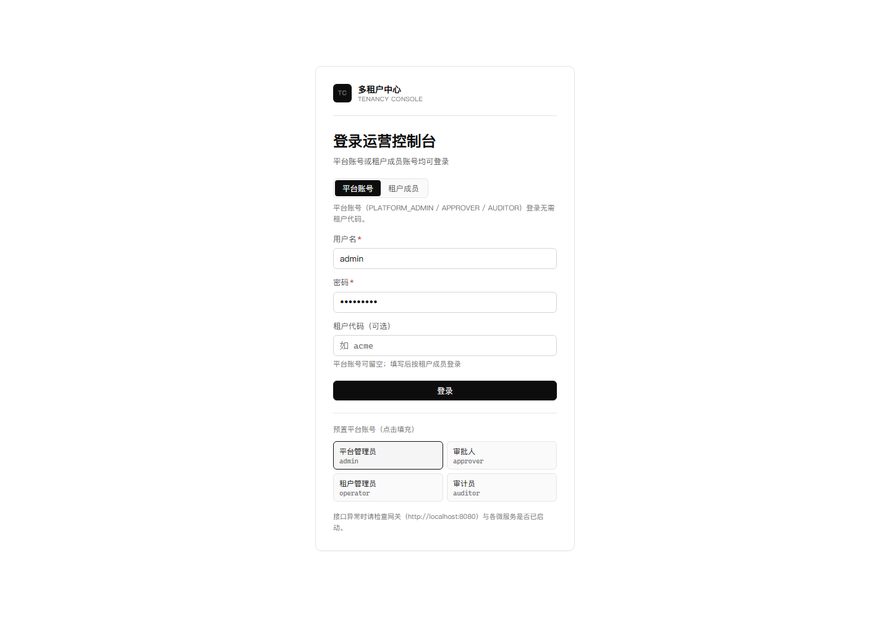
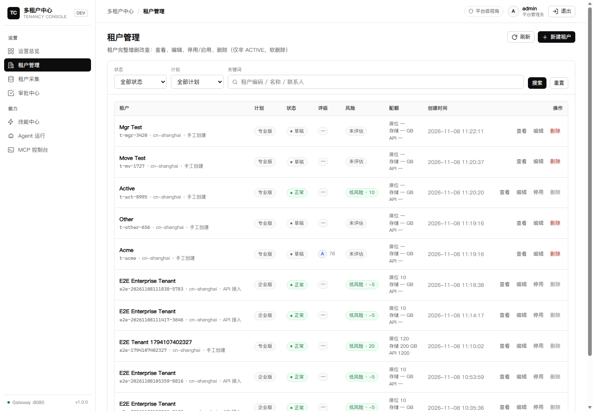
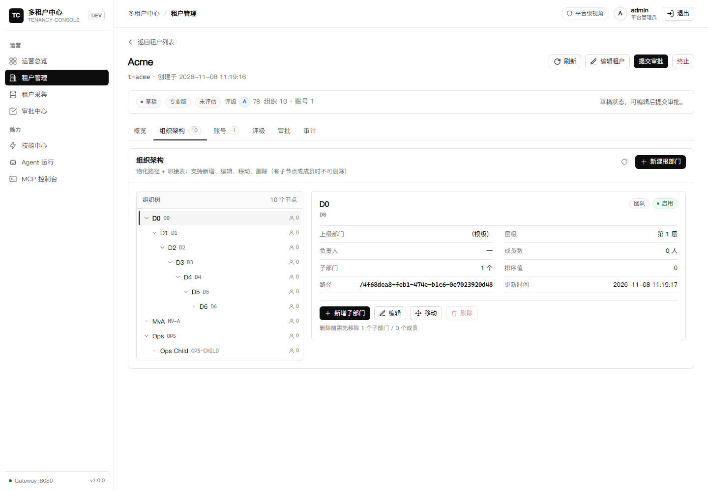

# 12 · 开发者工具极简 UI 规范（Codex-inspired 视觉参考）

> **免责声明**：本文中的 “Codex-inspired” 仅表示对开发者工具类产品极简视觉风格的参考，本项目与 OpenAI 及其 Codex 产品无任何关联、合作或背书；相关名称归其权利人所有。

## 1. 设计原则

1. **文字优先**：正文纯黑（`#0d0d0d`），白底，信息密度高，避免装饰性色块。
2. **细线分隔**：1px `#e5e5e5` 边框替代大阴影/大圆角；卡片圆角 ≤10px。
3. **无渐变/无彩色光晕**：去除 `radial-gradient`、彩色阴影、饱和背景。
4. **一致性**：所有按钮/输入/表格/徽章共用一套 token 与尺寸。
5. **可读性**：正文 ≥13.5px，行高 1.55，次要文字 `#525252`，禁用 `#8f8f8f`；正文对比度 ≥12:1。

## 2. Design Tokens（落到 `:root`）

```css
:root {
  --bg: #ffffff;
  --bg-subtle: #fafafa;
  --bg-hover: #f5f5f5;
  --surface: #ffffff;
  --border: #e5e5e5;
  --border-strong: #d4d4d4;
  --text: #0d0d0d;
  --text-2: #525252;
  --text-3: #737373;
  --text-disabled: #8f8f8f;
  --accent: #0d0d0d;
  --accent-contrast: #ffffff;
  --link: #2563eb;
  --green: #15803d;  --green-bg: #f0fdf4;
  --amber: #b45309;  --amber-bg: #fffbeb;
  --red: #b91c1c;    --red-bg: #fef2f2;
  --blue: #1d4ed8;   --blue-bg: #eff6ff;
  --radius-sm: 6px;
  --radius: 8px;
  --shadow: 0 1px 2px rgba(0,0,0,.04);
  --font: "Inter", "PingFang SC", "Microsoft YaHei", "Segoe UI", system-ui, sans-serif;
  --mono: ui-monospace, "Cascadia Code", Consolas, monospace;
  --sidebar-w: 232px;
  --topbar-h: 56px;
}
```

## 3. 布局

- **侧边栏 232px**：白底、右侧 1px 边框；顶部产品名（14px 600）+ 环境徽标；分组标题 11px 大写 `#737373`、字距 .04em；菜单项 32px 高、8px 内边距、圆角 6px，hover `--bg-hover`，active 黑底白字。
- **顶栏 56px**：面包屑（13px `#525252`）+ 右侧操作；底部 1px 边框；不吸顶阴影。
- **内容区**：最大宽 1320px，左右 28px，上下 20px；页面标题 20px/600，副标题 13px `--text-2`。
- **表格**：全宽、1px 外框、表头 `--bg-subtle` + 11.5px 大写 `#525252`、行高 44px、hover `--bg-hover`、无斑马纹；数字/ID 用等宽字体。
- **表单**：输入高 34px、1px 边框、圆角 6px；focus 黑色边框 + `0 0 0 3px rgba(13,13,13,.08)`；label 12.5px 500。
- **按钮**：高 32px、圆角 6px、13px/500；primary 黑底白字；secondary 白底黑字 1px 边框；ghost 无边框；danger 白底红字红边；disabled 半透明。
- **徽章**：12px 高 22px，浅底 + 深字 + 1px 同色系边框，圆角 999px。
- **抽屉/弹窗**：白底，遮罩 `rgba(0,0,0,.32)`，圆角 10px，无彩色阴影。
- **空态/加载/错误**：统一居中块，图标 20px `--text-2`，文案 13px；错误用 `--red` 文本 + 重试按钮。

## 4. 页面级要求

| 页面 | 关键点 |
|---|---|
| 登录 | 白底居中卡片（420px），标题 24px/600，黑色主按钮；平台账号/租户成员双模式 + 租户代码 + SSO 入口 |
| 总览 | KPI 卡“标签 + 大数字 + 细边框”；服务健康用圆点+文本；图表用黑/灰线条 |
| 租户列表 | 工具栏（搜索/状态/计划/新建）；行操作：查看、编辑、停用/启用、删除（二次确认）；评级列徽章 |
| 租户详情 | Tabs：概览、组织架构、账号、评级、审批、审计；URL 支持 `?tab=` |
| 组织架构 | 左树（缩进 16px/层）+ 右详情；新增子部门/移动/删除；导入组织 |
| 账号 | 筛选 + 表格 + 新建/编辑抽屉；一次性临时密码；导入账号；解锁/改密/登录历史 |
| 评级 | 等级徽标、五维水平条、最近 10 次趋势 SVG；评估/覆盖按角色显隐 |
| 技能 | **卡片网格 + 分页**；详情六页签：内容/代码/审查/调试/版本/启用 |
| MCP/Agent | 保持功能，按 token 重排；代码块/JSON 等宽字体浅灰底 |

## 5. 权限感知

- 顶栏展示角色 / 租户 / 组织；`mustChangePassword=true` 显示警示条；
- PLATFORM_ADMIN 全量；TENANT_ADMIN 本租户；ORG_ADMIN 子树；AUDITOR/MEMBER 只读；
- 无权限操作直接隐藏（后端仍强校验 403）。

## 6. 可访问性

- 所有交互元素可 Tab 聚焦，focus 可见（3px 半透明黑环）。
- 表格行操作使用 `aria-label`；删除确认文案明确。
- 颜色不作为唯一信息载体（徽章同时显示文字）。
- 中文排版：按钮/表头不换行；长 ID 省略号 + `title`。

## 7. 禁止项

- 禁止渐变背景、彩色 box-shadow、大圆角（>12px）、超过 3 种强调色同屏。
- 禁止仅用颜色区分状态；禁止隐藏纵向滚动导致表格截断。
- 不得引入 UI 框架（antd/element），继续手写 CSS + 现有组件。

## 8. 实机截图（k3s 部署）







> 截图来自本项目运行实例，用于确认白底/黑字/细边框/无渐变/紧凑表格。
